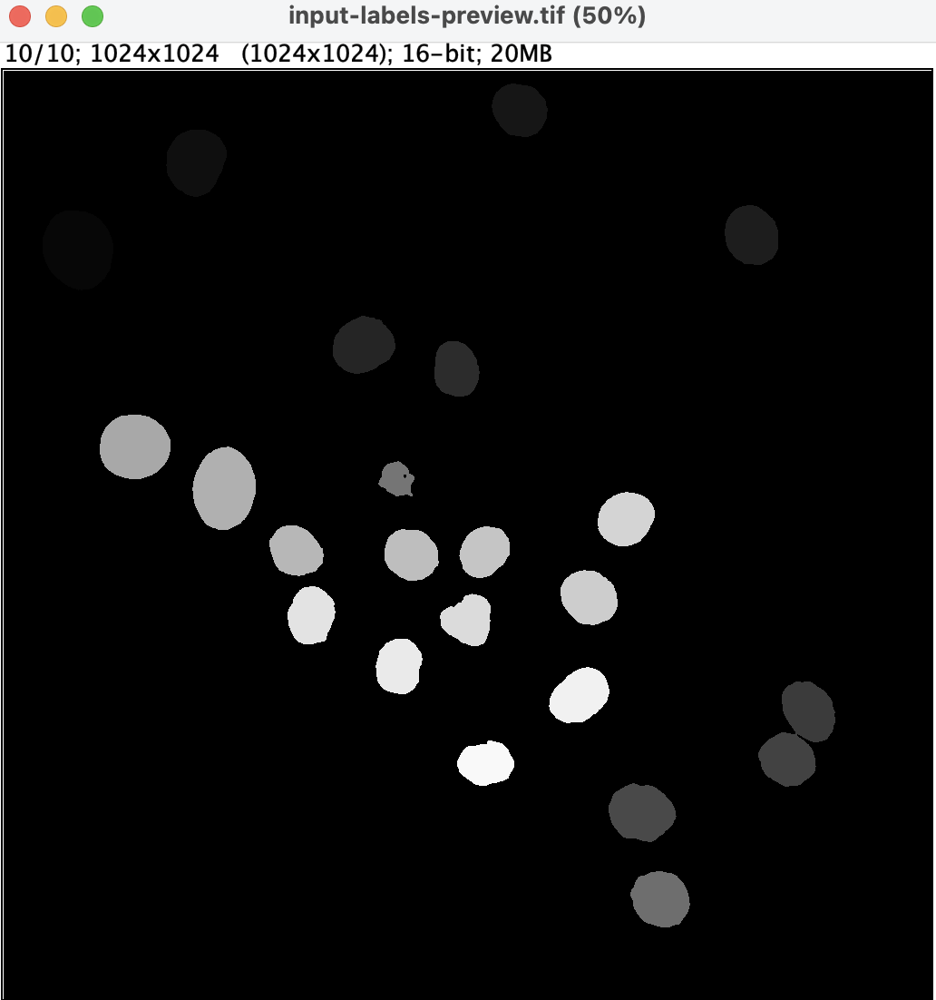

# Ultrack Cluster Setup and Smoke Test

This document records the commands, software versions, verification results,
and blockers encountered while setting up Ultrack on the DSI cluster. The
installation checks, Gurobi configuration, tracking stages, and output
verification are complete.

## Contents

- [Ultrack Cluster Setup and Smoke Test](#ultrack-cluster-setup-and-smoke-test)
  - [Contents](#contents)
  - [1. Setup Notes](#1-setup-notes)
    - [Environment](#environment)
    - [Installation](#installation)
      - [Configure Gurobi for cluster use](#configure-gurobi-for-cluster-use)
    - [Verify the installation](#verify-the-installation)
      - [Command-line interface](#command-line-interface)
      - [Python and Ultrack versions](#python-and-ultrack-versions)
      - [Gurobi](#gurobi)
    - [Important dependency versions](#important-dependency-versions)
    - [Setup troubleshooting](#setup-troubleshooting)
      - [Micromamba: Command not found i.e not available in the shell](#micromamba-command-not-found-ie-not-available-in-the-shell)
      - [Missing Qt binding](#missing-qt-binding)
  - [2. Testing a 2D Dataset](#2-testing-a-2d-dataset)
    - [Run history and troubleshooting](#run-history-and-troubleshooting)
    - [Final smoke-test record](#final-smoke-test-record)
      - [Test record](#test-record)
      - [Commands](#commands)
      - [Input inspection evidence](#input-inspection-evidence)
      - [Solver evidence](#solver-evidence)
      - [Output files](#output-files)
    - [Reproducing the smoke test](#reproducing-the-smoke-test)
    - [Issue #2 acceptance criteria](#issue-2-acceptance-criteria)

## 1. Setup Notes

This section explains how to recreate the Ultrack environment and configure
the optional Gurobi solver on the DSI cluster.

### Environment

| Item | Value |
| --- | --- |
| Micromamba environment | `cell-tracking-ultrack` |
| Python | `3.12.15` |
| Python compiler | GCC `15.3.0` |
| Ultrack | `0.8.0` |
| NumPy | `2.5.4` |
| pandas | `3.0.6` |
| PyTorch | `2.14.1` |
| Zarr | `3.4.1` |
| scikit-image | `0.26.0` |
| QtPy | `2.4.3` |
| PyQt5 | `5.15.11` |
| gurobipy | `13.0.3` |
| Gurobi license | Academic WLS, non-commercial use |

### Installation

The environment follows the
[official Ultrack installation instructions](https://royerlab.github.io/ultrack/)
and is defined in
[`environments/ultrack.yaml`](../environments/ultrack.yaml). Create and
activate it from the repository root with:

```bash
micromamba create --file environments/ultrack.yaml
micromamba activate cell-tracking-ultrack
```

The recipe pins the tested Python and Ultrack versions and includes PyQt 5,
which is required for Ultrack's command-line interface in this environment.

#### Configure Gurobi for cluster use

This step is required only when you want the Ultrack run to use Gurobi as its solver. Ultrack can
fall back to the open-source CBC solver when Gurobi is unavailable.

A standard named-user license is associated with one machine, which is not a
good fit for jobs that may run on different cluster nodes. Instead, request a
[free academic license](https://support.gurobi.com/hc/en-us/articles/360040541251-How-do-I-obtain-a-free-academic-license)
and select the Web License Service (WLS) option. Gurobi provides separate
[WLS setup instructions](https://support.gurobi.com/hc/en-us/articles/13232844297489-How-do-I-set-up-a-Web-License-Service-WLS-license).

After creating the WLS license in the Gurobi portal, download its API key as a
file named `gurobi.lic`. This file contains private credentials. Do not commit
it to Git, place it in the shared project data directory, paste its contents
into documentation, or share it with other users.

From a terminal on the local computer, copy the license into the private home
directory on the cluster:

```bash
scp ~/Downloads/gurobi.lic fe.ds:~/gurobi.lic
```

Then connect to the cluster and restrict the file so that only its owner can
read and modify it:

```bash
ssh fe.ds
chmod 600 ~/gurobi.lic
```

The home directory is shared across the DSI cluster nodes, so the license file
does not need to be copied separately for each new compute node. WLS requires
the compute node to be able to reach Gurobi's licensing service over the
internet.

After activating the Ultrack environment on a compute node, verify the
`gurobipy` layer:

```bash
ultrack check_gurobi
```

A successful check reports that the Gurobi module was imported, an academic
license was found, and a Gurobi environment was created. Do not copy the
license ID, account email, access ID, or secret into the repository.

```text
Gurobi module imported successfully.
Set parameter WLSAccessID
Set parameter WLSSecret
Set parameter LicenseID to value <xxxxxxx>
Academic license <xxxxxxx> - for non-commercial use only - registered to user@uchicago.edu
Gurobi environment created successfully.
```

Ultrack solves through Python-MIP, so verify that interface separately:

```bash
python -c "from mip import GUROBI, Model; model = Model(solver_name=GUROBI); print(model.solver_name)"
```

The expected final output is the following:
```text
Gurobi module imported successfully.
Set parameter WLSAccessID
Set parameter WLSSecret
Set parameter LicenseID to value <xxxxxxx>
Academic license <xxxxxxx> - for non-commercial use only - registered to user@uchicago.edu
GRB
```

If `ultrack check_gurobi` succeeds but this command raises `mip.exceptions.InterfacingError`, Gurobi is installed but the interface used by Ultrack is not yet working.

### Verify the installation

#### Command-line interface

Command:

```bash
ultrack --help
```

Result: succeeded. The command displayed the Ultrack command-line help and its
available commands, including `segment`, `link`, `solve`, `export`, and
`check_gurobi`.

#### Python and Ultrack versions

Command:

```bash
python -c "import sys, ultrack; print('Python:', sys.version); print('Ultrack:', ultrack.__version__)"
```

Result:

```text
Python: 3.12.15 (main, Oct 6 2026, 23:50:18) [GCC 15.3.0]
Ultrack: 0.8.0
```

#### Gurobi

Command:

```bash
ultrack check_gurobi
```

Result:

```text
Gurobi module imported successfully.
Academic license - for non-commercial use only
Gurobi environment created successfully.
```

This confirms that `gurobipy` can import Gurobi, find the academic Web License
Service (WLS) license, and create a Gurobi environment on the cluster. License
credentials and identifying details are intentionally omitted.

### Important dependency versions

The following compact version check was used to record the important direct
and runtime dependencies:

```bash
python -c "
from importlib.metadata import version

packages = [
    'ultrack', 'numpy', 'pandas', 'torch', 'zarr',
    'scikit-image', 'qtpy', 'PyQt5', 'gurobipy',
]

for package in packages:
    try:
        print(f'{package}: {version(package)}')
    except Exception:
        print(f'{package}: not installed')
"
```

The resolved versions are recorded in the Environment table above. A full
`pip freeze` is not included here because it contains many indirect packages
that are not useful in the short setup note.

### Setup troubleshooting

#### Micromamba: Command not found i.e not available in the shell

**Observed error:**

```text
bash: micromamba: command not found
```

That usually means either Micromamba is not installed, or it is installed but the compute-node shell has not loaded it

**Resolution:**

Installed and initialized Micromamba following the Clinic cluster
instructions, then created and activated the `cell-tracking-ultrack`
environment.

1. Exit the current compute allocation:

```bash
exit
```

2. Back on the `fe` login node, install Micromamba using the Clinic instructions:

```bash
cd ~
curl -Ls https://micro.mamba.pm/api/micromamba/linux-64/latest |
    tar -xvj bin/micromamba

~/bin/micromamba shell init -s bash -r ~/micromamba
source ~/.bashrc
micromamba config append channels conda-forge
micromamba --version
```

3. Request a compute node again

``` bash
srun -p general --time=02:00:00 --mem=16G --pty /bin/bash
```

4. On the compute node re-create or activate the environment

```bash
#activating
source ~/.bashrc
micromamba activate cell-tracking-ultrack

#if not created
micromamba create -y -n cell-tracking-ultrack python=3.12 pip
micromamba activate cell-tracking-ultrack

#verify that it works
which python
python --version
micromamba env list
```

#### Missing Qt binding

**Observed error:**

```text
qtpy.QtBindingsNotFoundError: No Qt bindings could be found
```

Cause: the pip installation included `qtpy`, which provides a common interface
to Qt, but did not provide a concrete Qt implementation.

**Resolution:**

```bash
micromamba install -y -c conda-forge "pyqt>=5.15.9,<6"
```

After installing PyQt 5, `ultrack --help` succeeded.

## 2. Testing a 2D Dataset

This section records what happened while inspecting and tracking a small 2D
CTC label sequence, including the errors encountered and their resolutions.

### Run history and troubleshooting

The following cluster-related errors and blockers were encountered during the dataset test. All cases were resolved with the following action step

| Error or blocker | Next action taken | Outcome |
| --- | --- | --- |
| Python-MIP could not load the initial Gurobi environment, so Ultrack fell back to CBC. | Follow [Configure Gurobi for cluster use](#configure-gurobi-for-cluster-use) to install a private academic WLS license and verify Python-MIP. | Resolved. Python-MIP reported `GRB`, and the final Ultrack run used Gurobi. |
| Slurm cancelled one attempt at 60% of node insertion because the allocation reached its time limit. | Request a longer allocation with `srun -p general --time=02:00:00 --mem=16G --pty /bin/bash`, then rerun from a clean output directory. | Resolved. The later run reached Gurobi and completed. |

### Final smoke-test record

Status: complete using Gurobi. Input inspection, segmentation, linking,
solving, and both final exports succeeded.

#### Test record

| Field | Value |
| --- | --- |
| Dataset | CTC `Fluo-N2DH-GOWT1` training data |
| Sequence and frames | Sequence `01_ST/SEG`; first 10 sorted TIFF files |
| Input type | Existing 2D instance-segmentation labels |
| Input array | Shape `(10, 1024, 1024)`; 16-bit labels |
| Label inspection | All 10 inspected frames had background value 0 and labels up to 34 |
| Configuration | Ultrack defaults except the working directory and requested solver `GUROBI` |
| Solver actually used | Gurobi through an academic WLS license |
| Output directory | `<PROJECT_DATA_ROOT>/runs/ultrack/ultrack-smoke-test` |
| Result | Successful; 230 tracks and all 10 segmentation masks exported |
| Solver runtime | 0.28 seconds reported by Gurobi |
| Overall runtime | Not recorded for this smoke test |
| Next action | Record the reproducible environment and request review |

#### Commands

The inspection-only command was:

```bash
python scripts/ultrack/ultrack_smoke_test.py \
    --input-dir <PROJECT_DATA_ROOT>/ctc/Fluo-N2DH-GOWT1/01_ST/SEG \
    --output-dir <PROJECT_DATA_ROOT>/runs/ultrack/ultrack-smoke-test \
    --inspect-only
```

The full smoke-test command was:

```bash
python scripts/ultrack/ultrack_smoke_test.py \
    --input-dir <PROJECT_DATA_ROOT>/ctc/Fluo-N2DH-GOWT1/01_ST/SEG \
    --output-dir <PROJECT_DATA_ROOT>/runs/ultrack/ultrack-smoke-test
```

`<PROJECT_DATA_ROOT>` represents the team's approved cluster data location and
is intentionally not committed as a private absolute path.

#### Input inspection evidence

The script prints the selected filenames, array shape, data type, and minimum
and maximum label in each frame. The TIFF stack was also opened in
[Fiji](https://fiji.sc/), and the segmented cells were visible across the 10
frames. Fiji is a distribution of ImageJ that includes tools and plugins for
scientific image analysis.

Because the preview was created on the cluster, it was downloaded by running
the following command from a terminal on the local computer:

```bash
scp fe.ds:<PROJECT_DATA_ROOT>/runs/ultrack/ultrack-smoke-test/input-labels-preview.tif ~/Downloads/
```

The stack initially appeared black in macOS Preview. This is not specific to
Preview: a general-purpose image viewer may display a 16-bit label image using
the full possible intensity range even though its label values occupy only a
small part of that range. A scientific image viewer allows the display range
to be adjusted, which showed the labeled cells correctly in Fiji. The
underlying mask values were not changed.



The screenshot shows frame 10 of the 10-frame, 1024-by-1024, 16-bit label
stack in Fiji. The adjusted display range makes the individual segmented cells
visible without changing the stored label values.

#### Solver evidence

Gurobi found an optimal solution with objective value `145.256660282` and a
zero gap. Ultrack then saved the solution and exported all 10 segmentation
masks. This establishes that the segmentation, linking, Gurobi solving, and
export stages all ran successfully.

```text
Optimize a model with 720 rows, 1153 columns and 2094 nonzeros (Max)
Variable types: 0 continuous, 1153 integer (1153 binary)
Explored 1 nodes (4 simplex iterations) in 0.28 seconds
Optimal solution found (tolerance 1.00e-03)
Best objective 1.452566602824e+02, best bound 1.452566602824e+02, gap 0.0000%
Saving solution ...
Done!
Exporting segmentation masks: 100% (10/10)
Tracks: 230
Output directory: <PROJECT_DATA_ROOT>/runs/ultrack/ultrack-smoke-test
```

#### Output files

The run produced the following artifacts:

```text
input-labels-preview.tif
tracks.csv
segments.zarr/
```

<!-- Optional: add a short `ls -lh` or `find` excerpt here after the clean run.
Do not commit the generated run directory. -->

### Reproducing the smoke test

From the repository root on the cluster:

1. If using Gurobi, complete
   [Configure Gurobi for cluster use](#configure-gurobi-for-cluster-use).

2. Request a compute node with enough time for database creation:

   ```bash
   srun -p general --time=02:00:00 --mem=16G --pty /bin/bash
   ```

3. On the compute node, create and activate the tested environment:

   ```bash
   source ~/.bashrc
   micromamba create --file environments/ultrack.yaml
   micromamba activate cell-tracking-ultrack
   ```

   If using Gurobi, run both verification commands from the setup section and
   confirm that the Python-MIP check prints `GRB`.

4. Run the smoke test, replacing `<PROJECT_DATA_ROOT>` with the team's approved
   cluster data location:

   ```bash
   python scripts/ultrack/ultrack_smoke_test.py \
       --input-dir <PROJECT_DATA_ROOT>/ctc/Fluo-N2DH-GOWT1/01_ST/SEG \
       --output-dir <PROJECT_DATA_ROOT>/runs/ultrack/ultrack-smoke-test
   ```

5. Confirm that the terminal reports an optimal solution, 230 tracks, and a
   complete 10-of-10 segmentation export. Verify that the output directory
   contains:

   ```text
   input-labels-preview.tif
   tracks.csv
   segments.zarr/
   ```

Use a new or empty output directory when reproducing the test so an existing
Ultrack database does not interfere with the run. Generated data and private
license files must not be committed to GitHub.

### Issue #2 acceptance criteria

- [x] Create an Ultrack environment on the cluster using the official
  installation instructions.
- [x] Record the Ultrack version, Python version, important dependency
  versions, and exact installation commands.
- [x] Run an Ultrack smoke test using a small subset of the selected 2D
  dataset.
- [x] Record the exact command and configuration used, whether the run
  succeeded, and where its output was stored.
- [x] Document significant errors or blockers and the action taken for each
  one.
- [x] Add this reproducible setup note and the smoke-test results to GitHub.

The final item can be checked after this document and its label screenshot are
committed and pushed to the issue branch.
