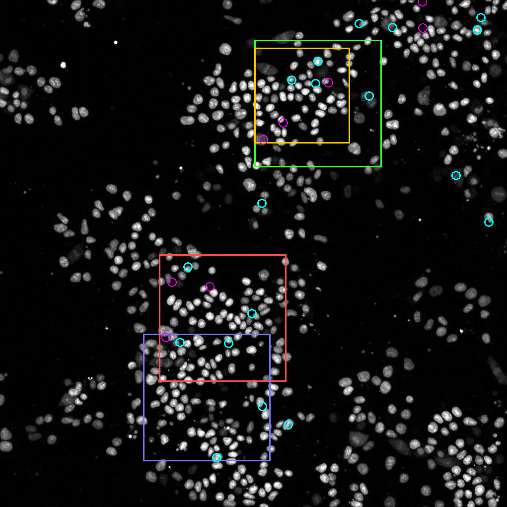
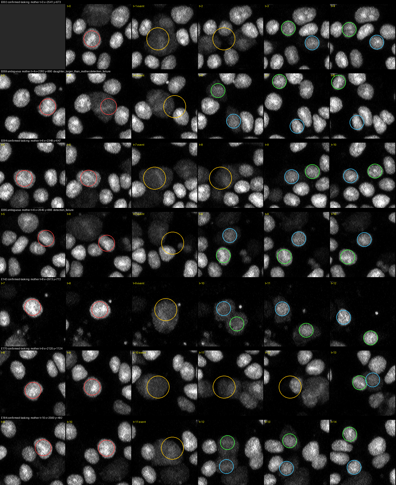

# Cell Region Selection for Annotation

Nov 10, 2026 · @Khadija Lawal Shuaib

## Summary

We will annotate a 1024 × 1024 px region of the upper colony, top-left corner at x = 2048, y = 320, over frames 0–16 (17:00 to 22:20 of imaging). It was the best-scoring region in a scan of the whole field: it contains 4 confirmed-looking divisions plus 3 plausible ones, about 71 moving nuclei per frame, and keeps about 78% of tracked nuclei inside for the whole movie.

## Data

| Property | Value |
| --- | --- |
| File | MAX\_ch1\_z3\_10\_Loose\_colonies\_H2B\_T\_17HRSto24HRS\_20minintervals-2-2.tif |
| Content | Max projection of z-slices 3–10, nuclear (H2B) channel, loose colonies |
| Size | 4084 × 4084 px, 21 frames (0–20), 16-bit |
| Frame interval | 20 min, 17:00 to 24:00 of imaging |

Frame 20 was excluded from all analysis. Its signal drops to about a fifth of the earlier frames across most of the field, and it may follow an unusual time gap.

## Selection criteria

The region should meet most of these:

| Criterion | How it was measured |
| --- | --- |
| Several cells visibly move | Tracked nuclei (followed ≥ 8 frames) whose net displacement exceeds 80 px, about one nucleus width |
| At least one nucleus rounds up and divides into two daughters | Division events confirmed by eye on montages, with both daughters persisting ≥ 3 frames |
| Most nuclei remain inside the crop | Share of tracked nuclei that start inside and stay inside for their whole track |
| Both separated and moderately crowded cells | Share of nuclei whose nearest neighbour is < 75 px (crowded) vs > 110 px (separated) |
| Signal stays visible throughout | Lowest-to-highest ratio of median nucleus brightness in the crop over the frames used |

## Method

1. **Detect nuclei** in every frame (0–19): background subtraction, Otsu threshold, and watershed to split touching nuclei. This found about 600 nuclei in frame 0, rising to about 750 by frame 19.
2. **Track nuclei** between consecutive frames by optimal one-to-one matching within 45 px. Nuclei move a median of about 20 px per frame.
3. **Check for stage drift.** The shift between frames differs by region, and isolated cells barely move (about 2 px per frame). The motion is real collective migration, so no drift correction was applied.
4. **Detect candidate divisions.** These are a nucleus that dims and spreads (or drops out), followed within 3 frames by two nearby nuclei. Each candidate is flagged for crossing, overlap, detection failure, daughters not persisting, asymmetric daughters, or too late to verify.
5. **Review by eye.** Six-frame montages (two frames before the event to three after) were inspected for all automatically confirmed candidates and for persistent ambiguous candidates in the leading regions. Each was labelled confirmed-looking, plausible, ambiguous, or rejected.
6. **Score windows.** All 1024 × 1024 and 768 × 768 windows on a 64 px grid were scored on the criteria above. Confirmed-looking divisions count fully and plausible ones count half; windows that are too sparse or too dense are penalised.

## How divisions look in this movie

A dividing nucleus goes dim and diffuse, not bright. Over 1–2 frames it rounds up and its signal spreads into a larger, faint blob. Two dim daughters then appear close together, separate, and brighten over the next few frames.

A first detector that looked for bright, condensed chromatin mostly found false events: neighbours crossing in, nuclei briefly dropping out of detection, and dying cells that fragment into very bright pieces. Rebuilding the detector around the dimming pattern and checking montages by eye gave this breakdown across the field (frames 0–19):

| Label | Events |
| --- | --- |
| Confirmed-looking | 18 |
| Plausible | 8 |
| Ambiguous (mostly automated only) | 280 |
| Rejected | 12 |

## Results

The upper colony scored highest at both window sizes. The densest colony, picked before divisions were checked by eye, fell well behind because most of its "divisions" were crossings or tracking errors. Scores use frames 0–19; corners are (x, y) of the top-left pixel.

| Candidate | Size (px) | Confirmed + plausible divisions | Nuclei staying inside | Nuclei per frame | Score |
| --- | --- | --- | --- | --- | --- |
| **Upper colony (chosen): (2048, 320)** | 1024 | 4 + 3 | 78% | \~71 | 13.2 |
| Upper colony, shifted left: (1920, 320) | 1024 | 3 + 3 | 80% | \~78 | 13.3 |
| Upper colony, smaller: (2048, 384) | 768 | 3 + 3 | 75% | \~53 | 12.9 |
| Middle colony: (1280, 2048) | 1024 | 4 + 2 | 78% | \~91 | 12.8 |
| Lower colony (first pick): (1152, 2688) | 1024 | 2 + 0 | 91% | \~91 | 9.9 |

The shifted-left window scores marginally higher but leaves out one confirmed division (E142), so the chosen window keeps all four.

&#91;image: Field at frame 10 with candidate crops and divisions marked\]

*Frame 10, downsampled. Green = chosen 1024 crop, yellow = 768 alternative, red = middle colony, purple = lower colony (first pick). Cyan circles = confirmed-looking divisions, magenta = plausible.*

**Divisions inside the chosen crop.** Positions are full-image pixels; subtract (2048, 320) for crop coordinates. Edge distance is for the mother or daughter nearest the boundary.

| Event | Label | Mother (frame: x, y) | Daughters (frame: x, y) | Daughters tracked after split (frames) | Distance to edge (px) |
| --- | --- | --- | --- | --- | --- |
| E002 | Confirmed-looking | 0: 2541, 674 | 3: (2535, 632), (2628, 690) | 16 / 4 | 312 |
| E059 | Plausible | 4: 2283, 990 | 6: (2193, 928), (2254, 1048) | 13 / 13 | 145 |
| E094 | Confirmed-looking | 6: 2349, 647 | 9: (2450, 622), (2368, 641) | 10 / 10 | 301 |
| E095 | Plausible (dim neighbour may be the true mother) | 6: 2645, 666 | 8: (2586, 715), (2611, 637) | 11 / 11 | 299 |
| E142 | Confirmed-looking | 8: 2973, 773 | 10: (2994, 829), (2942, 768) | 3 / 9 | 78 |
| E170 | Plausible (dim for 3 frames, daughters overlap at first) | 9: 2121, 1125 | 13: (2135, 1107), (2185, 1097) | 6 / 6 | 73 |
| E184 | Confirmed-looking | 10: 2561, 492 | 12: (2518, 470), (2513, 565) | 7 / 7 | 150 |

*Each row runs from two frames before the event to three after. Red = mother, yellow = rounded-up dim stage, green and blue = the two daughters.*

## Final selection

| Setting | Value |
| --- | --- |
| Region | x 2048–3071, y 320–1343 (1024 × 1024 px) |
| Frames | 0–16 (17 frames, 17:00 to 22:20 of imaging) |
| Divisions covered | 4 confirmed-looking + 3 plausible, each with at least 3 frames of daughters before frame 16 |

Frames 0–16 were chosen over 0–19 to cut annotation effort by about 15% (roughly 1,200 instead of 1,400 nuclei). The trade-off is the last hour of movement.

To reproduce in Fiji (frames there are numbered from 1):

1. Open the TIFF and run `makeRectangle(2048, 320, 1024, 1024);`
2. Image › Duplicate, tick "Duplicate hyperstack", and set frames to 1–17.

## Limitations

- **Most real divisions are still unlabelled.** Nuclei grow from about 608 to 756 over frames 0–19, implying roughly 150 divisions across the field. Only 18 were confirmed and 8 marked plausible; the rest sit among the 280 ambiguous candidates.
- **The ranking could favour sparser regions.** Crowded areas produce more ambiguous calls, and 28 ambiguous events in the middle colony (1280, 2048) were not reviewed by eye.
- **The separated-vs-crowded criterion is weak everywhere.** Its score is about 0.1 in the top windows. The chosen crop has a dense centre with looser cells along its right and bottom edges.
- **The score weights are a judgement call.** The top three windows are within 0.5 points of each other, so small weight changes could reorder them.
- **Two divisions sit near the crop edge.** E142 is 78 px from the right edge and E170 is 73 px from the bottom edge, so their daughters may drift out late in the clip.

## Files

All outputs are in `CLS Data/crop_analysis/`:

| File or folder | Contents |
| --- | --- |
| `division_events.csv` | All 318 candidates: mother and daughter positions and frames, persistence, automated flags, review label, distance to crop edges |
| `divisions_v2/` | One montage per candidate (two frames before the event to three after). Use the CSV's label column; file names show the automated label only |
| `recommended_crop_divisions.png` | Montages of the 7 divisions inside the chosen crop |
| `overview_v2.png` | Frame 10 with candidate crops and confirmed and plausible divisions marked |
| `review_sheets/` | The montage sheets reviewed by eye |
| `superseded/` | First-pass outputs from the brightness-based detector; do not use |
