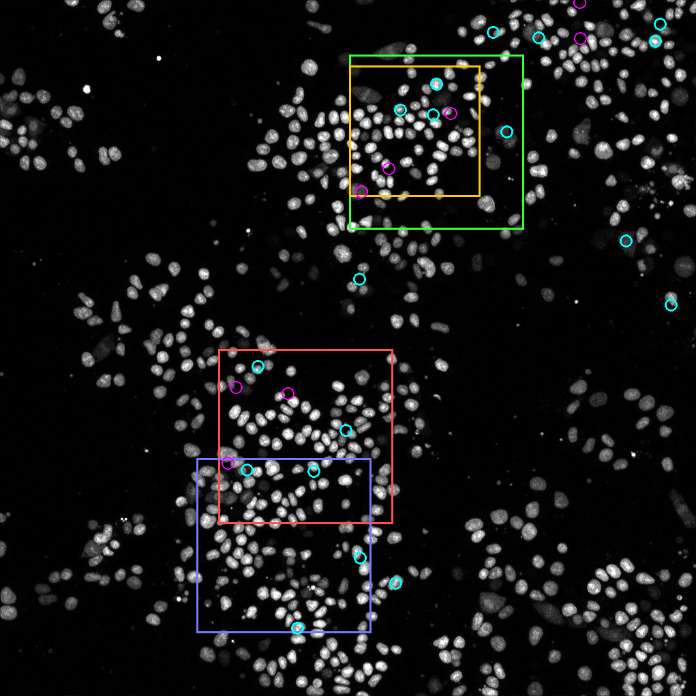
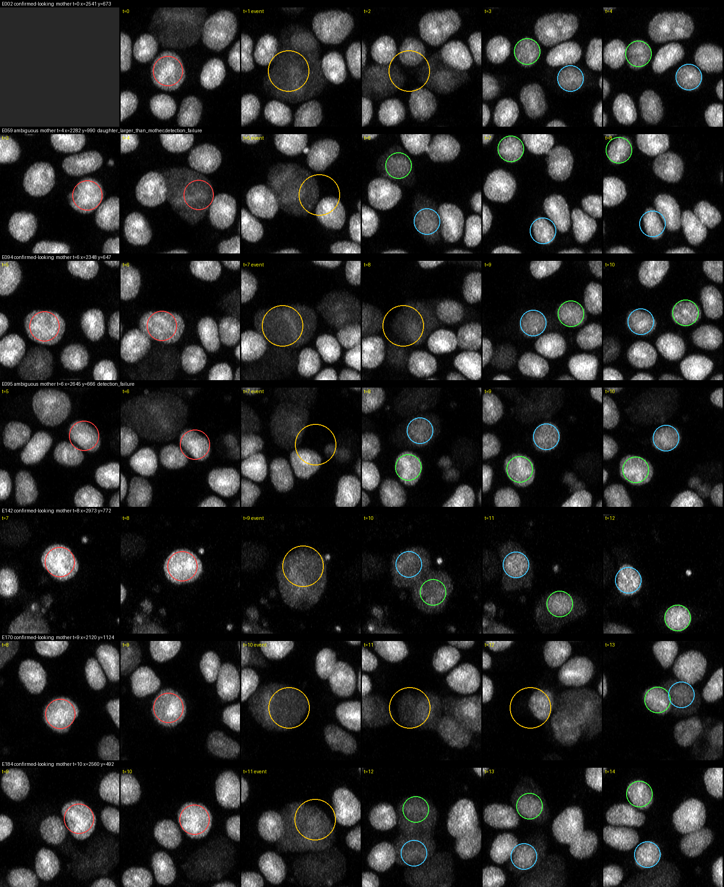
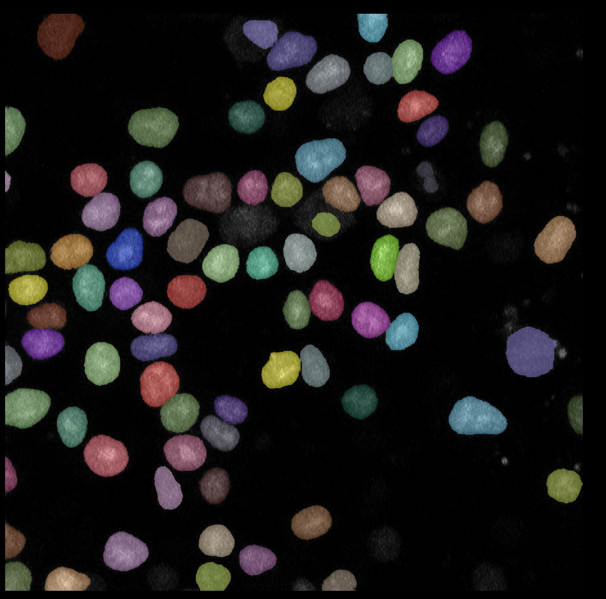
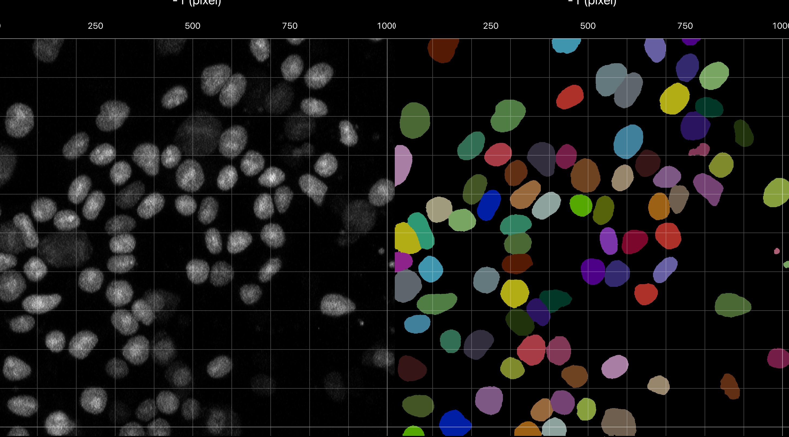
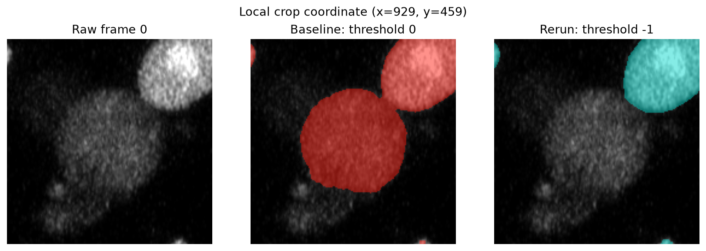

# CLS 2D annotation pilot

This document records the evolving plan, decisions, conventions, and status
for building a small manually corrected reference dataset from the CLS loose
colony movie. It is intentionally separate from software installation.

For the verified Apple Silicon environment, follow the
[local macOS setup](ultrack-setup.md#local-macos-setup). The annotation
workflow begins only after Cellpose, Napari, Ultrack, and Gurobi pass the
checks in that section.

- [CLS 2D annotation pilot](#cls-2d-annotation-pilot)
  - [Goal](#goal)
  - [Selected source and subset](#selected-source-and-subset)
    - [Selection criteria](#selection-criteria)
    - [Method](#method)
  - [How divisions look in this movie](#how-divisions-look-in-this-movie)
    - [Results](#results)
    - [Candidate division events](#candidate-division-events)
  - [Prepare the fixed image subset in Fiji](#prepare-the-fixed-image-subset-in-fiji)
  - [Automated initialization](#automated-initialization)
    - [Cellpose smoke test](#cellpose-smoke-test)
      - [Smoke-test result](#smoke-test-result)
      - [Visual inspection and cell-probability comparison](#visual-inspection-and-cell-probability-comparison)
      - [Provisional full-subset run at `-0.5`](#provisional-full-subset-run-at--05)
  - [Manual correction conventions](#manual-correction-conventions)
  - [Artifacts to preserve](#artifacts-to-preserve)
  - [Quality assurance and evaluation](#quality-assurance-and-evaluation)
  - [Current status](#current-status)


## Goal

Create a manageable reference subset that contains nuclear movement, crowded
and separated cells, and several divisions. Cellpose and Ultrack provide the
initial masks and tracks. Those automated results are then manually corrected
in Napari rather than drawing the complete dataset from scratch.

The corrected result will support local segmentation and tracking evaluation.
It is a project reference annotation, not a claim of complete annotation for
the original movie.

## Selected source and subset

Treat the original movie as read-only.

| Item | Selection |
| --- | --- |
| Source movie | `MAX_ch1_z3_10_Loose_colonies_H2B_T_17HRSto24HRS_20minintervals-2-2.tif` |
| Biological signal | H2B nuclear fluorescence |
| Source structure | 2D maximum projection over time |
| Full image size | 4084 by 4084 pixels |
| Available frames | 21 |
| Frame interval | 20 minutes |
| Spatial crop | `x=2048`, `y=320`, width `1024`, height `1024` |
| Data frame indices | 0 through 16 |
| Fiji frame numbers | 1 through 17 |
| Selected duration | 17 frames spanning 5 hours and 20 minutes |
| Frames outside the pilot | Data frames 17–19 were omitted to reduce annotation work; frame 20 was excluded because it may follow an unusual time gap |
| Downsampling | None |
| Baseline Cellpose labels in smoke-test frames | 85, 88, and 82 in frames 0, 1, and 2; these are predictions, not ground-truth counts |

This region was selected because it combines a dense center with looser cells
near the right and bottom edges, visible movement, and several candidate
division events. Approximately 78 percent of the automatically tracked nuclei
were estimated to remain within the crop during the earlier crop-selection
analysis, before the interval was shortened to frames 0–16. These automated
counts supported subset selection but do not constitute ground truth.

### Selection criteria

The region should meet most of these:

| Criterion | How it was measured |
| --- | --- |
| Several cells visibly move | Tracked nuclei (followed ≥ 8 frames) whose net displacement exceeds 80 px, about one nucleus width |
| At least one nucleus rounds up and divides into two daughters | Division events confirmed by eye on montages, with both daughters persisting ≥ 3 frames |
| Most nuclei remain inside the crop | Share of tracked nuclei that start inside and stay inside for their whole track |
| Both separated and moderately crowded cells | Share of nuclei whose nearest neighbour is < 75 px (crowded) vs > 110 px (separated) |
| Signal stays visible throughout | Lowest-to-highest ratio of median nucleus brightness in the crop over the frames used |

### Method

1. **Detect nuclei** in every frame (0–19): background subtraction, Otsu threshold, and watershed to split touching nuclei. This found about 600 nuclei in frame 0, rising to about 750 by frame 19.
2. **Track nuclei** between consecutive frames by optimal one-to-one matching within 45 px. Nuclei move a median of about 20 px per frame.
3. **Check for stage drift.** The shift between frames differs by region, and isolated cells barely move (about 2 px per frame). The motion is real collective migration, so no drift correction was applied.
4. **Detect candidate divisions.** These are a nucleus that dims and spreads (or drops out), followed within 3 frames by two nearby nuclei. Each candidate is flagged for crossing, overlap, detection failure, daughters not persisting, asymmetric daughters, or too late to verify.
5. **Review by eye.** Six-frame montages (two frames before the event to three after) were inspected for all automatically confirmed candidates and for persistent ambiguous candidates in the leading regions. Each was labelled confirmed-looking, plausible, ambiguous, or rejected.
6. **Score windows.** All 1024 × 1024 and 768 × 768 windows on a 64 px grid were scored on the criteria above. Confirmed-looking divisions count fully and plausible ones count half; windows that are too sparse or too dense are penalised.

## How divisions look in this movie

A dividing nucleus goes dim and diffuse, not bright. Over 1–2 frames it rounds up and its signal spreads into a larger, faint blob. Two dim daughters then appear close together, separate, and brighten over the next few frames.

A first detector that looked for bright, condensed chromatin mostly found false events: neighbours crossing in, nuclei briefly dropping out of detection, and dying cells that fragment into very bright pieces. Rebuilding the detector around the dimming pattern and checking montages by eye gave this breakdown across the field (frames 0–19):

| Label | Events |
| --- | --- |
| Confirmed-looking | 18 |
| Plausible | 8 |
| Ambiguous (mostly automated only) | 280 |
| Rejected | 12 |

### Results

The upper colony scored highest at both window sizes. The densest colony, picked before divisions were checked by eye, fell well behind because most of its "divisions" were crossings or tracking errors. Scores use frames 0–19; corners are (x, y) of the top-left pixel.

| Candidate | Size (px) | Confirmed + plausible divisions | Nuclei staying inside | Nuclei per frame | Score |
| --- | --- | --- | --- | --- | --- |
| **Upper colony (chosen): (2048, 320)** | 1024 | 4 + 3 | 78% | \~71 | 13.2 |
| Upper colony, shifted left: (1920, 320) | 1024 | 3 + 3 | 80% | \~78 | 13.3 |
| Upper colony, smaller: (2048, 384) | 768 | 3 + 3 | 75% | \~53 | 12.9 |
| Middle colony: (1280, 2048) | 1024 | 4 + 2 | 78% | \~91 | 12.8 |
| Lower colony (first pick): (1152, 2688) | 1024 | 2 + 0 | 91% | \~91 | 9.9 |

The shifted-left window scores marginally higher but leaves out one confirmed division (E142), so the chosen window keeps all four.



&#91;image: Field at frame 10 with candidate crops and divisions marked\]

*Frame 10, downsampled. Green = chosen 1024 crop, yellow = 768 alternative, red = middle colony, purple = lower colony (first pick). Cyan circles = confirmed-looking divisions, magenta = plausible.*

**Divisions inside the chosen crop.** Positions are full-image pixels; subtract (2048, 320) for crop coordinates. Edge distance is for the mother or daughter nearest the boundary.

### Candidate division events

The following events were identified during crop selection. Coordinates are in the full source image.

| Event | Label | Mother (frame: x, y) | Daughters (frame: x, y) | Daughters tracked after split (frames) | Distance to edge (px) |
| --- | --- | --- | --- | --- | --- |
| E002 | Confirmed-looking | 0: 2541, 674 | 3: (2535, 632), (2628, 690) | 16 / 4 | 312 |
| E059 | Plausible | 4: 2283, 990 | 6: (2193, 928), (2254, 1048) | 13 / 13 | 145 |
| E094 | Confirmed-looking | 6: 2349, 647 | 9: (2450, 622), (2368, 641) | 10 / 10 | 301 |
| E095 | Plausible (dim neighbour may be the true mother) | 6: 2645, 666 | 8: (2586, 715), (2611, 637) | 11 / 11 | 299 |
| E142 | Confirmed-looking | 8: 2973, 773 | 10: (2994, 829), (2942, 768) | 3 / 9 | 78 |
| E170 | Plausible (dim for 3 frames, daughters overlap at first) | 9: 2121, 1125 | 13: (2135, 1107), (2185, 1097) | 6 / 6 | 73 |
| E184 | Confirmed-looking | 10: 2561, 492 | 12: (2518, 470), (2513, 565) | 7 / 7 | 150 |



*Each row runs from two frames before the event to three after. Red = mother, yellow = rounded-up dim stage, green and blue = the two daughters.*

In this movie, a dividing nucleus may become dim and spread out for one or two
frames before two dim daughters appear and brighten. A candidate becomes a
confirmed annotated division only when one mother can be followed into two
daughters and both daughters persist in later frames. Crossing cells,
projection overlap, segmentation failure, and boundary entry must be ruled out.

## Prepare the fixed image subset in Fiji

Create the crop from the original TIFF, not from a screenshot or a
contrast-adjusted export.

1. Open the source movie in Fiji.
2. Create the rectangle:

   ```text
   makeRectangle(2048, 320, 1024, 1024)
   ```

3. Use **Image -> Duplicate** and select Fiji frames 1 through 17.
4. Preserve the original bit depth and do not apply display contrast to the
   stored pixels.
5. Export the subset as a TIFF image sequence for data frames 0 through 16.
6. Verify that every image is 1024 by 1024 pixels and that exactly 17 frames
   were exported.

The current Fiji export uses descriptive source filenames. A `runner_input`
subdirectory contains lightweight links normalized to `t000.tif` through
`t016.tif`, which is the filename convention expected by the reusable 2D
runner. The derived data are stored in the ignored local directory:

```text
external/data/cropped_movies_frame0_16/
```

Keep the image sequence and all derived outputs outside Git. Store the source
filename, crop coordinates, frame mapping, and interval with the annotation
metadata.

## Automated initialization

The initialization order is:

```text
fixed raw subset
    -> Cellpose nuclear segmentation
    -> Ultrack segmentation, linking, and solving
    -> manual correction in Napari
    -> corrected reference masks and lineage
```

Preserve the original Cellpose and Ultrack outputs. Manual corrections must be
saved as separate artifacts so the automated result can later be evaluated
against the corrected reference.

### Cellpose smoke test

Activate the verified local environment and set untracked local paths:

```bash
conda activate ultrack-cell-tracking-local
export CLS_CROP_DIR="$PWD/external/data/cropped_movies_frame0_16/runner_input"
export CLS_RUN_ROOT="$PWD/external/runs"
```

Run an initial CPU test on the first three consecutive frames:

```bash
python scripts/ultrack/run_2d_benchmark.py \
  --input-dir "$CLS_CROP_DIR" \
  --output-dir "$CLS_RUN_ROOT/cls-cellpose-nuclei-three-frame" \
  --sequence CLS \
  --method cellpose \
  --cellpose-model nuclei \
  --frame-start 0 \
  --frame-stop 3 \
  --labels-only
```

Do not add `--cellpose-gpu` in the verified local environment. Inspect missed
nuclei, false detections, mergers, and splits before processing all frames.
Record the measured nuclear diameter and every non-default Cellpose setting.
Use a new output directory for each configuration.

#### Smoke-test result

The labels-only smoke test completed successfully on frames 0 through 2.

| Item | Recorded result |
| --- | --- |
| Input | Three `1024 × 1024` uint16 frames |
| Model | Cellpose `nuclei` |
| Diameter | Automatic (`None`) |
| Channels | `[0, 0]`, grayscale with no second channel |
| Flow threshold | `0.4` |
| Cell-probability threshold | `0.0` |
| GPU requested | `False` |
| Label counts | Frame 0: 85; frame 1: 88; frame 2: 82 |
| Instance-segmentation runtime | 95.19 seconds total |
| Output | `external/runs/cls-cellpose-nuclei-three-frame/` |
| Run report | `external/runs/cls-cellpose-nuclei-three-frame/run_report.json` |

The completed run establishes that local inference and output recording work.
The label counts alone do not establish segmentation accuracy. The masks still
need visual inspection for missed nuclei, false detections, mergers, splits,
and consistency across frames before this configuration is selected for the
complete subset.

#### Visual inspection and cell-probability comparison

The baseline labels were inspected in Napari over the raw images with label
opacity set to approximately `0.45`. Overall segmentation was strong, but a
small number of faint or diffuse nuclei were missed. To test whether a more
permissive Cellpose cutoff recovered these nuclei, the same three frames were
rerun with `cellprob_threshold=-1.0`. All other recorded settings were kept the
same.



*Baseline frame-0 inspection in Napari. The semi-transparent overlay makes it
possible to compare predicted boundaries with the nuclear signal and identify
unlabeled nuclei.*

| Item | Baseline | More permissive run |
| --- | --- | --- |
| Cell-probability threshold | `0.0` | `-1.0` |
| Frame 0 labels | 85 | 86 |
| Frame 1 labels | 88 | 89 |
| Frame 2 labels | 82 | 82 |
| Runtime | 95.19 seconds | 79.34 seconds |
| Output | `external/runs/cls-cellpose-nuclei-three-frame/` | `external/runs/cls-cellpose-nuclei-cellprob-minus1-three-frame/` |

The object counts alone made the `-1.0` run appear slightly better, but direct
mask comparison showed a mixed result:

| Frame | Direct comparison with the baseline |
| --- | --- |
| 0 | Two masks with no baseline overlap appeared, but one baseline mask disappeared. The foreground masks differed over approximately 2.62% of the frame. |
| 1 | One new mask appeared and no complete baseline object disappeared. The foreground masks differed over approximately 1.84% of the frame. |
| 2 | The object count was unchanged, but existing foreground masks expanded. The foreground masks differed over approximately 1.47% of the frame. |



*Raw frame 0 and the `-1.0` labels shown side by side. This view is useful for
assessing the entire field, although exact missing masks are easier to confirm
with overlays or a focused comparison.*

The new frame-0 detections were centered near local crop coordinates
`(x=789, y=288)` and `(x=866, y=897)`. The first was also detected near
`(x=781, y=281)` in frame 1, suggesting that it represents a persistent faint
nucleus rather than an isolated artifact.

However, the `-1.0` run lost a large, faint nucleus centered near local crop
coordinate `(x=929, y=459)`, or approximately `(x=2977, y=779)` in the full
source image. The baseline mask covered 5,968 pixels at this location, while
the more permissive run did not produce a mask for it. This example was easier
to verify by overlaying each label image on the raw frame than by viewing the
raw image and labels side by side.



*Focused frame-0 comparison at local crop coordinate `(x=929, y=459)`. The
baseline mask is shown in red and the `-1.0` result in cyan. The large, faint
nucleus is segmented by the baseline but absent from the more permissive run.*

Therefore, lowering the cell-probability threshold to `-1.0` is not considered
a clear improvement: it recovers some faint nuclei, expands several masks, and
also introduces a genuine-looking temporal miss.

#### Provisional full-subset run at `-0.5`

An intermediate threshold of `-0.5` was selected as the provisional
configuration for the weekly baseline. Cellpose was run over all 17 pilot
frames while the model, automatic diameter, channels, flow threshold, and CPU
setting remained unchanged.

| Item | Recorded result |
| --- | --- |
| Frames | 0–16 |
| Cell-probability threshold | `-0.5` |
| Label counts by frame | 0: 87; 1: 89; 2: 82; 3: 82; 4: 79; 5: 79; 6: 79; 7: 78; 8: 78; 9: 80; 10: 79; 11: 79; 12: 79; 13: 79; 14: 74; 15: 74; 16: 73 |
| Instance-segmentation runtime | 297.08 seconds total |
| Output | `external/runs/cls-cellpose-nuclei-cellprob-minus0p5-frames0-16/` |
| Run report | `external/runs/cls-cellpose-nuclei-cellprob-minus0p5-frames0-16/run_report.json` |

For the three frames shared with the earlier smoke tests, `-0.5` produced two
additional non-overlapping masks in frame 0, one in frame 1, and no new object
in frame 2. It did not completely lose any baseline object in those frames.
Compared with threshold `0.0`, foreground disagreement was approximately
1.17%, 0.96%, and 0.76% for frames 0, 1, and 2, respectively. Importantly, the
large faint frame-0 nucleus lost at threshold `-1.0` remained segmented at
`-0.5`.

The object count decreases from 87–89 near the start to 73 in frame 16. These
are predicted instance counts rather than ground truth; the trend must be
checked across the image sequence to distinguish genuine crop entry or exit
from missed faint nuclei, mergers, or other segmentation changes. The `-0.5`
configuration is suitable as the provisional weekly baseline, but it may be
revised after visual inspection or manual correction.

Ultrack can use this provisional segmentation after a quick full-sequence
inspection confirms that there are no systematic failures. Do not tune solver
weights until the required nuclei and candidate links exist.

## Manual correction conventions

The following conventions are the starting policy and should be refined with
the mentor as ambiguous examples are encountered:

- One label represents one visible nucleus in one frame.
- Split touching nuclei only when a defensible boundary or temporal evidence
  supports the split.
- Exclude isolated bright debris that cannot be followed as a nucleus.
- Flag ambiguous overlaps caused by the maximum projection instead of silently
  inventing a boundary.
- Keep a mother's track identity until the division event; give each daughter
  a new identity linked to the mother.
- Treat genuine entry into or exit from the crop as an appearance or
  disappearance, not as an annotation error.
- Review segmentation corrections before correcting tracking identities,
  because changed masks can alter centroids and links.
- Record every unresolved object, division, or boundary event in an annotation
  log.

## Artifacts to preserve

Store these outside Git in a clearly named pilot directory:

```text
cls-loose-colony-pilot/
  raw-frames/
  automated-cellpose/
  automated-ultrack/
  corrected-labels/
  corrected-tracks/
  metadata/
  annotation-log/
```

The metadata should include:

- source identifier and crop/frame selection;
- image shape, bit depth, and frame interval;
- package and model versions;
- complete Cellpose and Ultrack configurations;
- annotator and reviewer names;
- annotation dates and convention version;
- ambiguous or excluded objects;
- automated and corrected object, track, and division counts; and
- any evaluation metrics computed from the corrected reference.

## Quality assurance and evaluation

Before calling the subset complete:

1. review every frame for missing, merged, split, and spurious masks;
2. review every track transition between consecutive frames;
3. review every proposed division using frames before and after it;
4. inspect track starts and ends near the crop boundary;
5. have a second team member review the division events and a sample of
   corrected masks when possible; and
6. preserve the automated baseline so segmentation and tracking errors can be
   measured separately.

The exact evaluation format and metrics will be added after confirming how the
corrected Napari labels and lineage are exported.

## Current status

| Step | Status | Notes |
| --- | --- | --- |
| Source movie selected | Complete | Loose-colony H2B maximum-projection movie. |
| Crop and frame range selected | Complete | `1024 × 1024` crop at `x=2048`, `y=320`; data frames 0–16. |
| Anomalous final frame excluded | Complete | Data frame 20 was excluded because it may follow an unusual time gap. |
| Local software environment verified | Complete | Apple Silicon environment, Napari, Ultrack, and Gurobi checks passed. |
| Raw subset exported from Fiji | Complete | 17 uint16 frames, indexed 0–16. |
| Runner-compatible frame names prepared | Complete | `t000.tif`–`t016.tif` in `runner_input`. |
| Cellpose smoke test | Complete | Labels saved for frames 0–2; counts were 85, 88, and 82. |
| Cellpose smoke-test visual inspection | Complete | The baseline missed some faint nuclei; threshold `-1.0` recovered some masks but lost a large faint nucleus in frame 0. |
| Cellpose configuration selected | Complete | Threshold `-0.5` is the provisional weekly baseline and can be revised after review. |
| Full-subset Cellpose run | Complete | Frames 0–16 were processed; predicted counts ranged from 73 to 89. |
| Full-subset segmentation review | Pending | Inspect all frames, especially the decline in predicted counts toward frames 14–16. |
| Ultrack baseline run | Not started | Begin after accepting the Cellpose configuration. |
| Segmentation correction | Not started | Correct the accepted automated masks in Napari. |
| Tracking and division correction | Not started | Correct identities, links, starts, ends, and divisions. |
| Second-person review | Not started | Review divisions and a sample of corrected masks when possible. |
| Evaluation | Not started | Final format and metrics depend on the corrected export. |
