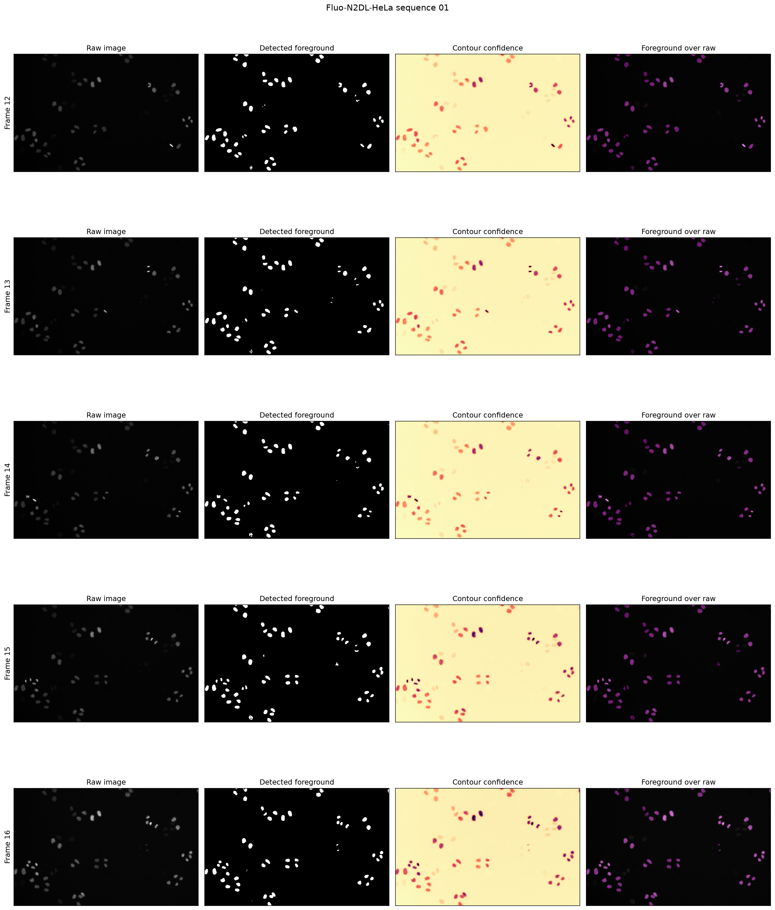
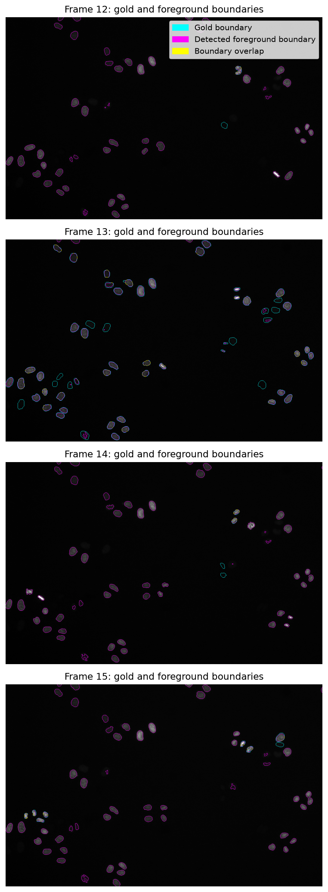
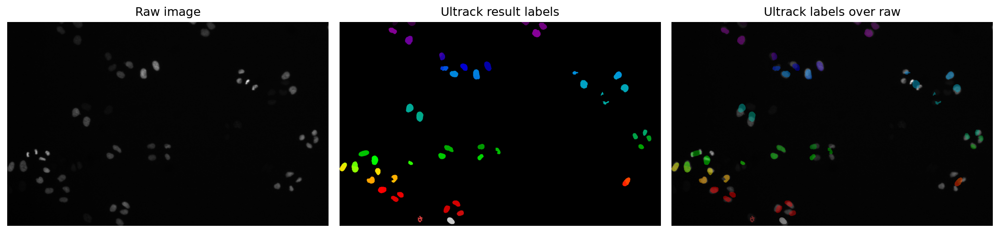

# Initial Ultrack experiment on a five-frame HeLa subset

## Purpose

This experiment tested whether the project could run the complete Ultrack
workflow on raw fluorescence microscopy images. It used a small subset so that
the foreground and contour inputs could be inspected before running a complete
sequence.

The experiment successfully completed all four stages:

1. create foreground and contour maps from raw images;
2. generate segmentation hypotheses;
3. link candidate segments across frames; and
4. solve and export the selected tracks.

This was an exploratory pipeline test, not a final Cell Tracking Challenge
(CTC) benchmark.

## Data and configuration

| Item | Value |
| --- | --- |
| Dataset | `Fluo-N2DL-HeLa` |
| Sequence | `01` |
| Original frames | 12--16 |
| Number of frames | 5 |
| Image size | 700 x 1100 pixels |
| Image data type | `uint16` |
| Ultrack version | 0.8.0 |
| Python version | 3.12.15 |
| Foreground method | Ultrack `detect_foreground` |
| Contour method | Ultrack `robust_invert` |
| Ultrack solver | Gurobi |

The raw-image parameters were:

| Parameter | Value |
| --- | ---: |
| Foreground sigma | 15.0 |
| Remove histogram mode | `False` |
| Minimum foreground | 0.0 |
| Contour sigma | 1.0 |

These values are a reproducible starting point based on the defaults of
Ultrack 0.8.0. They were not taken from the published HeLa experiment. The
published experiment used watershed, Cellpose, StarDist, and an ensemble of
those segmentation inputs, so this run should not be described as a direct
reproduction of the published benchmark.

## Foreground and contour inspection

The foreground occupied approximately 2.6%--2.9% of each image. This was
fairly stable across the five frames.

| Frame | Foreground fraction | Contour maximum | Contour mean |
| ---: | ---: | ---: | ---: |
| 12 | 0.026448 | 0.074888 | 0.072899 |
| 13 | 0.026156 | 0.074858 | 0.072890 |
| 14 | 0.026410 | 0.078667 | 0.076677 |
| 15 | 0.029171 | 0.059711 | 0.057691 |
| 16 | 0.026671 | 0.053492 | 0.051373 |

The foreground generally follows the brighter nuclei. Visual inspection also
shows missed or incomplete detections for some dim nuclei. The contour maps
retain internal boundary information that Ultrack can use when considering
alternative segmentation hypotheses.



## Diagnostic comparison with sparse gold segmentation

The gold segmentation is sparse: an unlabeled area is not necessarily
background, and not every visible cell is annotated in every frame. Therefore,
the analysis did not penalize detections outside the annotated regions.

For each annotated gold object, the analysis found the connected component in
the detected foreground with the largest overlap and calculated:

- **gold coverage:** intersection divided by the gold object's area; and
- **intersection over union (IoU):** intersection divided by the union of the
  gold object and its best-overlapping detected component.

An object was counted as covered when at least 50% of its gold pixels were
included in the detected foreground.

| Frame | Annotated objects | Covered at 50% | Mean gold coverage | Median gold coverage | Median IoU |
| ---: | ---: | ---: | ---: | ---: | ---: |
| 12 | 2 | 1 | 0.417012 | 0.417012 | 0.410204 |
| 13 | 59 | 44 | 0.637004 | 0.816129 | 0.816129 |
| 14 | 4 | 2 | 0.452406 | 0.439560 | 0.428571 |
| 15 | 8 | 7 | 0.712441 | 0.804089 | 0.801132 |

Frame 16 was excluded from gold-based measurements because it has no gold
segmentation file. It was retained for qualitative inspection and for checking
temporal continuity.

The boundary overlay uses cyan for gold boundaries, magenta for detected
foreground boundaries, and yellow where the two boundaries overlap. It makes
missed cells and incomplete foreground regions easier to see. Frames 13 and 15
have relatively high median coverage and IoU, while frames 12 and 14 contain
very few annotations and include missed objects. Because the annotations are
sparse and uneven across frames, these values are diagnostic rather than a
final segmentation score.



This comparison also has two important limitations:

- it evaluates the binary foreground input, not the final Ultrack instance
  segmentation; and
- each gold object is matched independently, so the calculation is not a
  one-to-one assignment between gold and detected objects.

Official CTC metrics should be calculated on the final outputs of a complete
sequence.

## Ultrack execution and cluster behavior

The successful run used different parallel settings for different stages:

| Stage | Parallel setting | Recorded runtime |
| --- | ---: | ---: |
| Segmentation hypotheses | 4 workers | approximately 7 minutes 12 seconds |
| Linking | 1 worker | approximately 4 seconds |
| Optimization | 4 Gurobi threads | approximately 0.5 seconds for the solver |

Four segmentation workers completed successfully. Four linking workers,
however, produced `sqlite3.OperationalError: database is locked`. The Ultrack
SQLite database was stored on the shared `/net` filesystem, where simultaneous
writes from multiple linking workers caused lock contention. Re-running the
linking stage with one worker completed successfully. The working configuration
for this storage location is therefore:

```python
config.data_config.n_workers = 1
config.segmentation_config.n_workers = 4
config.linking_config.n_workers = 1
config.tracking_config.n_threads = 4
```

The progress bar for segmentation remained at 0% for several minutes even
though the worker processes were active. It advanced only after a frame's work
returned to the main process. A stationary progress bar at the beginning of
this stage is therefore not, by itself, evidence that the run is stuck.

## Tracking output

The five-frame run produced:

- 329 rows in the track table;
- 88 unique track IDs; and
- 16 entries in the lineage graph.

The result labels align with many of the brighter visible nuclei in the
inspected frame. Dimmer nuclei that were absent from the foreground input could
not be recovered by the tracking stage.



The CTC export starts at `mask000.tif`, so output frame `000` corresponds to
original raw frame `012` for this subset. The earlier attempt passed the integer
`FRAME_START` to the `first_frame` argument of `tracker.to_ctc`. That argument
expects a labeled image used to select starting tracks, not a numeric frame
offset. Removing the argument fixed the export.

## Conclusions and next steps

This experiment confirms that the raw-image-to-track Ultrack workflow runs
end-to-end on the DSI cluster. It also establishes a practical worker
configuration for an SQLite database on shared storage.

The run does not yet establish final tracking accuracy. The next steps are:

1. review the missed and partially covered gold objects and decide whether to
   adjust the foreground parameters or use a stronger segmentation input;
2. run the selected configuration on a complete sequence using a new run name;
3. evaluate the final instance segmentation and lineage output with the CTC
   metrics; and
4. compare results only with published experiments that use a compatible data
   split and segmentation input.

The complete executable record, including plots and console output, remains in
[`01_hela_raw_to_tracks.ipynb`](../../notebooks/ultrack/01_hela_raw_to_tracks.ipynb).
