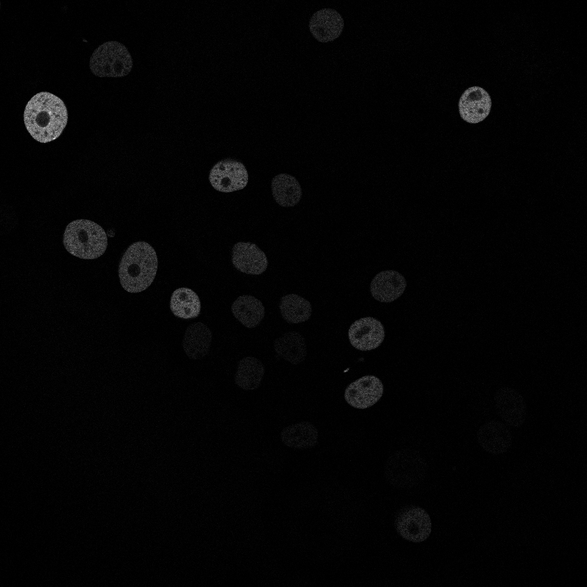
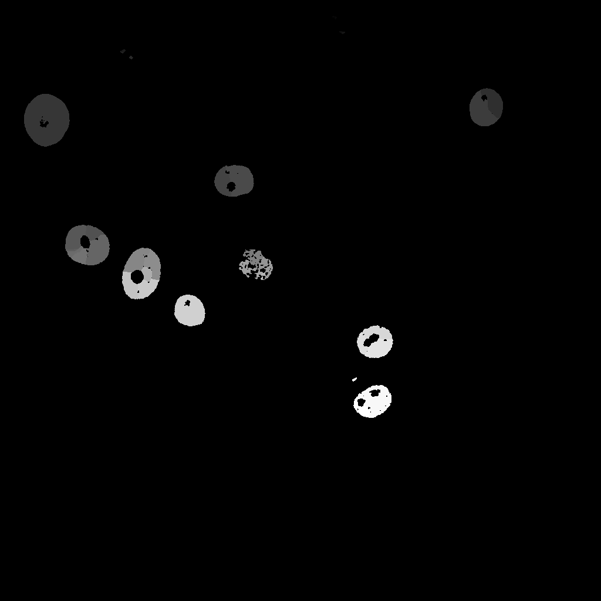
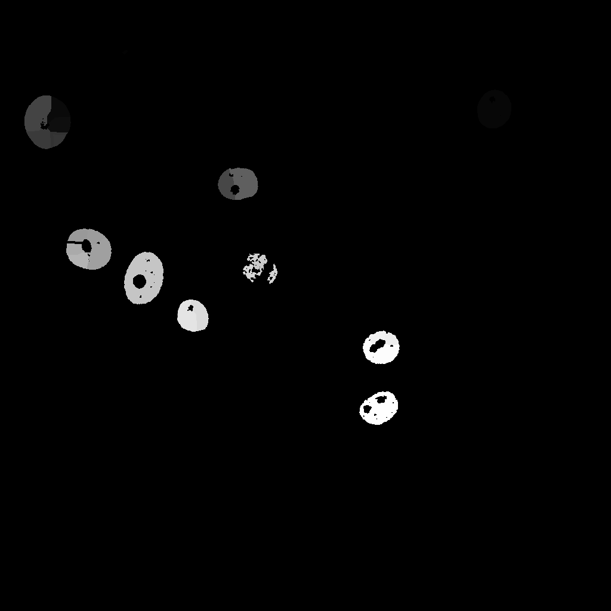
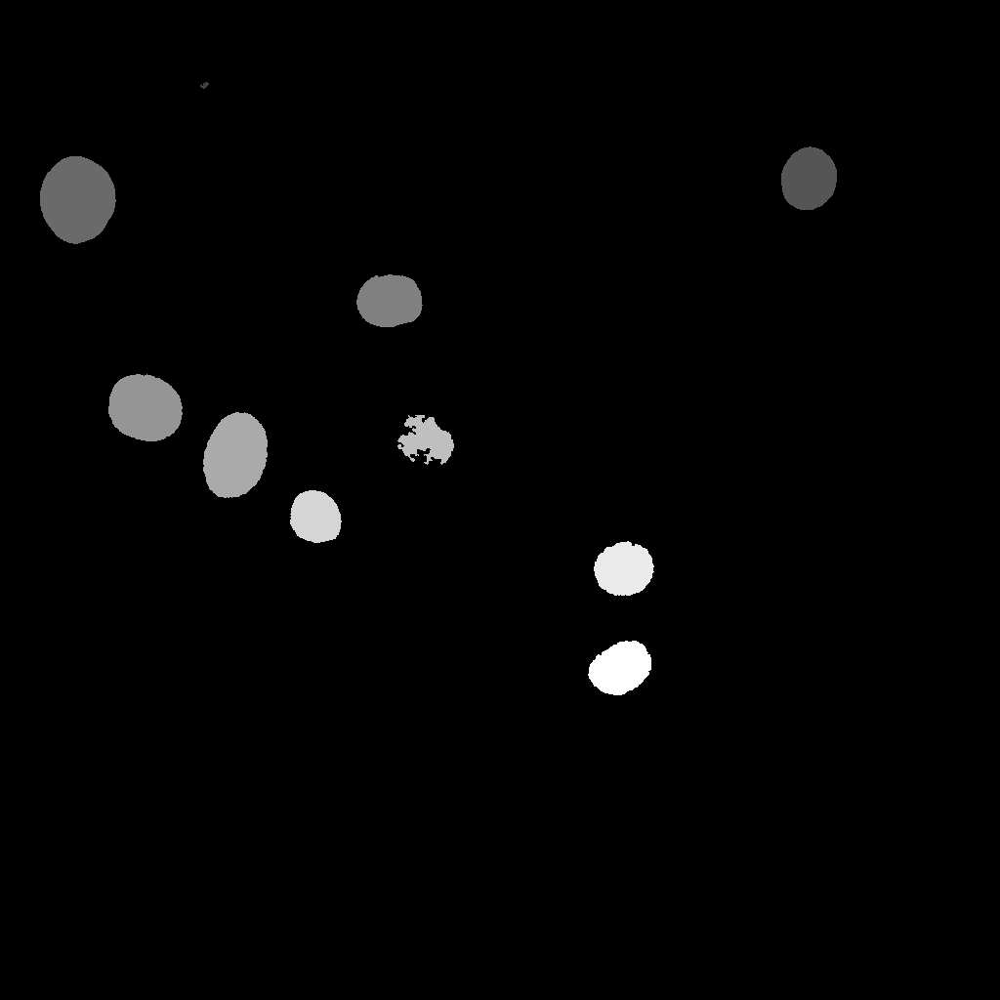

# Ultrack parameter analysis

This document records preprocessing comparisons and parameter sensitivity
experiments, organized by dataset and segmentation method. Plain watershed and
hole-filled watershed are treated as separate methods. Smoothing settings are
variants within each method. All reported scores evaluate the resulting
segmentation-and-Ultrack pipeline.

Original reproduction results remain in [Ultrack experiment results](ultrack-results.md).
Execution details are in [Ultrack reproducibility](ultrack-reproducibility.md).
These follow-up experiments investigate project performance; they are not new
reproductions of published parameter settings.

## Experimentation plan and status

Status reflects the results documented below, rather than every experiment
available in the runner. Unless noted otherwise, completed dataset comparisons
cover both sequences 01 and 02. A partially completed plan row does not reopen
the reduced-smoothing issue task, which is complete; the wider sweep is optional
follow-up work.

| Experiment | Dataset | Motivation | Baseline | Variants | Keep fixed | Status |
| --- | --- | --- | --- | --- | --- | --- |
| Hole filling | GOWT1 | Reduce watershed over-segmentation caused by holes. | No filling | Fill foreground holes before distance transform and watershed | All thresholds and smoothing | **Complete:** both sequences evaluated and documented. |
| Watershed image smoothing | HeLa, GOWT1 | Reduce oversized predicted masks. | Sigma 1 | Sigma 0.5 and 0 | Hole-filling choice and other parameters | **Partial plan coverage:** GOWT1 hole-filled watershed at sigma 0.5 is complete and performed worse. Sigma 0 and HeLa variants are unreported, optional follow-up. |
| Ultrack contour smoothing | HeLa, GOWT1 | Improve boundary agreement with ground truth. | Sigma 4 | Sigma 2 and 0 | Reuse identical segmentation masks and tracking configuration | **Complete for Cellpose inputs:** both datasets and sequences. Other methods and ensemble sweeps remain optional follow-up. |
| StarDist probability | HeLa, GOWT1 | Balance missed cells and false detections. | Loaded model default 0.479071 | 0.4 and 0.6 | NMS at 0.3, contour sigma 4, and other settings | **In progress:** HeLa complete on both sequences; GOWT1 pending. |
| StarDist NMS | HeLa, GOWT1 | Balance duplicate suppression and separation of nearby cells. | Loaded model default 0.3 | 0.2 and 0.4 | Probability at 0.479071, contour sigma 4, and other settings | **Pending:** no results reported for either dataset. |
| Cellpose 3D segmentation | MDA231, H157 | Improve segmentation in noisy backgrounds and support H157. | Official U-Net → Ultrack on MDA231 public sequence 01; no matching official Ultrack U-Net setup established for H157 | Cellpose 3D masks → Ultrack | Within each comparison, match raw sequence, annotations, and evaluation procedure; record model-specific settings and any tracking differences | **MDA231 complete:** OP_CTB 0.262026 versus U-Net 0.643768; improvement not established. **H157 blocked:** data download unavailable when attempted. See [3D experiment results](ultrack-results.md#cellpose-3d). |

## Contents

- [Experimentation plan and status](#experimentation-plan-and-status)
- [Parameter definitions](#parameter-definitions)
  - [Cellpose cell probability threshold](#cellpose-cell-probability-threshold-cellprob_threshold)
  - [StarDist probability threshold](#stardist-probability-threshold-prob_thresh)
  - [Ultrack contour smoothing](#ultrack-contour-smoothing-contour_sigma)
- [Fluo-N2DH-GOWT1](#fluo-n2dh-gowt1)
  - [Watershed](#watershed)
    - [Watershed comparison overview](#watershed-comparison-overview)
    - [Plain watershed](#plain-watershed)
    - [Hole-filled watershed](#hole-filled-watershed)
  - [Cellpose](#cellpose)
    - [Cell probability threshold](#cell-probability-threshold)
    - [Contour smoothing](#contour-smoothing)
- [Fluo-N2DL-HeLa](#fluo-n2dl-hela)
  - [Cellpose](#cellpose-1)
    - [Cell probability threshold](#cell-probability-threshold-1)
    - [Contour smoothing](#contour-smoothing-1)
  - [StarDist](#stardist)
    - [Probability threshold](#probability-threshold)
- [Remaining Week 5 issue tasks](#remaining-week-5-issue-tasks)
- [Recommended next steps](#recommended-next-steps)

## Parameter definitions

These definitions apply to both datasets. Dataset sections below record the
experiments and results.

### Cellpose cell probability threshold (`cellprob_threshold`)

#### Implementation verification

The installed Cellpose **3.1.1.3** implementation was inspected in the
`cell-tracking-ultrack-cellpose` environment used for the 2D HeLa and GOWT1
experiments. The supplied inspection JSON records `dynamics.compute_masks`
with the default `cellprob_threshold=0.0` and these source lines:

```python
if (cellprob > cellprob_threshold).sum():
    inds = np.nonzero(cellprob > cellprob_threshold)
```

The source also masks the flow field using the same comparison when calling
`follow_flows`. Thus, at threshold zero, pixels with a foreground score
**strictly greater than zero** are eligible for mask dynamics. Scores equal
to zero are excluded. Passing the cutoff does not guarantee a final instance:
flow dynamics and subsequent mask filtering still determine the output.

The source files inspected were `cellpose/models.py` and
`cellpose/dynamics.py` in that environment. The top-level `Cellpose.eval`
signature accepts `**kwargs`; its extracted documentation describes the same
threshold rule. The explicit default and comparison above come from
`compute_masks`, rather than from the top-level signature.

#### What the threshold means

Cellpose's [version 3 settings documentation](https://cellpose.readthedocs.io/en/v3.1.1.1/settings.html)
explains that this foreground score is an input to a sigmoid, rather than an
already normalized probability. Accordingly, zero corresponds mathematically
to sigmoid(0) = 0.5, and the implemented strict score cutoff corresponds to
sigmoid(score) > 0.5. It does **not** mean accepting zero-probability pixels,
disabling filtering, or selecting an automatic/adaptive threshold. This
interpretation does not establish that the transformed scores are calibrated
probabilities.

Lowering the cutoff admits more pixels to dynamics; raising it admits fewer.
The final number and quality of objects need not change monotonically because
mask construction also depends on predicted flows and filtering.

#### Recorded baseline and evidence

The existing 2D runner explicitly passes `cellprob_threshold=0.0`, matching the
verified default. No new inference or threshold tuning was needed to verify
this issue task. The supplied JSON's `interpretation` field is an explanatory
statement produced by our inspection tool; the signatures and source lines
are the direct evidence from the installed package. The sigmoid interpretation
is supported separately by the Cellpose documentation cited above.

Preserve the inspection output outside Git at:

```text
<parameter-output-root>/cellpose_threshold_inspection.json
```

**Status: implementation verification complete for Cellpose 3.1.1.3 in the
2D experiment environment.** This record applies to both HeLa and GOWT1; it
does not independently verify the separate Cellpose 4 environment used for 3D.

### StarDist probability threshold (`prob_thresh`)

StarDist predicts an object-probability score and distances to the object
boundary at candidate locations. `prob_thresh` is the minimum score used to
select candidates for instance construction. It acts on the model's predicted
object scores, not on raw image brightness, and does not represent a guaranteed
probability that a completed mask is correct.

- **Lower threshold:** admits more candidates, potentially recovering dim or
  uncertain objects while also admitting more false detections.
- **Higher threshold:** excludes lower-scoring candidates, potentially reducing
  false detections while missing more real objects.

Non-maximum suppression (NMS) subsequently removes overlapping candidates.
Consequently, candidate admission does not directly determine the final object
count, and a lower threshold does not guarantee better segmentation or tracking.

The loaded `2D_versatile_fluo` model reported **`prob_thresh=0.479071`** and
**`nms_thresh=0.3`**. These are that model's loaded defaults, not universal
StarDist settings. The HeLa probability experiment tests 0.4 and 0.6 against
the loaded probability default, keeping NMS at 0.3 and Ultrack contour sigma
at 4. Defaults should be recorded again if the model or environment changes.

This differs from Cellpose's pre-sigmoid `cellprob_threshold`; their numerical
values are not directly interchangeable.

### Ultrack contour smoothing (`contour_sigma`)

Ultrack converts the saved Cellpose object labels into a foreground mask and
an image of object boundaries (the contour map). The contour-smoothing parameter,
`contour_sigma`, controls the width of the Gaussian filter applied to that
boundary map, measured in pixels for these 2D experiments.

- **Sigma 4:** the baseline; spreads boundary values over a wider neighborhood.
- **Sigma 2:** applies a narrower smoothing filter.
- **Sigma 0:** applies no contour smoothing, preserving sharp label boundaries.

These maps guide Ultrack's segmentation hypotheses and therefore can affect
its final masks and tracks. Changing sigma does not rerun Cellpose or edit its
saved input labels. It also does not guarantee smaller final masks: the effect
on boundary placement must be checked against ground truth. This parameter is
part of Ultrack's input conversion, rather than Cellpose's neural network.

Contour smoothing is distinct from the Gaussian **image** smoothing tested
inside watershed on GOWT1, which occurs before Otsu thresholding.

## Fluo-N2DH-GOWT1

### Watershed

#### Watershed comparison overview

Full public training sequences 01 and 02 were evaluated against their
corresponding CTC ground truth. Scores range from 0 to 1; higher is better.
Values below are rounded to six decimals.

| Sequence | Method | Image smoothing sigma | DET | SEG | TRA | OP_CTB |
| --- | --- | ---: | ---: | ---: | ---: | ---: |
| 01 | Plain watershed | 1.0 | 0.097911 | 0.075761 | 0.112959 | 0.094360 |
| 01 | Hole-filled watershed | 1.0 | **0.422692** | **0.246408** | **0.427822** | **0.337115** |
| 01 | Hole-filled watershed | 0.5 | 0.397182 | 0.233387 | 0.402243 | 0.317815 |
| 02 | Plain watershed | 1.0 | 0.076003 | 0.163528 | 0.093791 | 0.128659 |
| 02 | Hole-filled watershed | 1.0 | **0.347239** | **0.450789** | **0.353262** | **0.402026** |
| 02 | Hole-filled watershed | 0.5 | 0.344617 | 0.394356 | 0.347687 | 0.371022 |

Bold identifies the best tested watershed variant within each sequence, not
the best method overall. The previously recorded Cellpose and StarDist results
remain higher than these watershed results.

#### Plain watershed

##### Configuration

The original baseline uses per-frame Otsu thresholding, small-object removal,
distance-transform seed detection, and watershed. No binary hole filling is
applied. Recorded settings are Gaussian image smoothing sigma 1, h-maxima
height 2 (the CLI option is named `--watershed-h-minima`), minimum object size
20 pixels, and Ultrack contour smoothing sigma 4.

##### Reference results and records

The baseline values in the comparison table are taken from the existing
[GOWT1 results](ultrack-results.md#fluo-n2dh-gowt1). OP_CTB is approximately
9.4% for sequence 01 and 12.9% for sequence 02.

Baseline run directories:

```text
<ULTRACK_RUN_ROOT>/gowt1-seq01-full-watershed/
<ULTRACK_RUN_ROOT>/gowt1-seq02-full-watershed/
```

#### Hole-filled watershed

##### Motivation

During the mentor meeting, holes in foreground masks were identified as a
possible contributor to watershed over-segmentation on GOWT1. Enclosed gaps can
alter the distance transform and its seed locations, potentially splitting a
single cell into multiple regions. Filling these gaps before watershed tests
that explanation. In crowded regions, however, an enclosed background gap may
also be filled, so aggregate score gains do not establish correct separation
of every touching cell.

##### Method

Binary hole filling is applied independently to each 2D foreground mask,
after Otsu thresholding and small-object removal, but before the distance
transform and seed detection. The implementation uses
`scipy.ndimage.binary_fill_holes`, enabled by `--watershed-fill-holes`.
Raw fluorescence images are unchanged. This preprocessing is specific to
watershed; Cellpose and StarDist are not modified.

##### Raw-image example



**GOWT1, sequence 01, frame 0 (`t000`).** This user-supplied
raw-image screenshot shows dark enclosed interiors in several bright objects,
particularly near the upper-left edge. After foreground thresholding, these
interiors may become holes that affect the distance transform and watershed
seeds. This illustrates the motivation for hole filling; the raw image alone
does not establish the resulting foreground or segmentation errors.

Dim objects are also visible. Filling enclosed foreground holes does not by
itself recover objects excluded by thresholding. A subsequent comparison should
show this same frame/crop as raw image, foreground before and after filling,
and watershed labels with and without filling, keeping all other settings fixed.

##### Plain watershed label example



**GOWT1, sequence 01, frame 0 (`input_labels/mask000.tif`), plain watershed.**
This user-supplied screenshot shows the predicted instance labels supplied to
Ultrack, not an intermediate thresholded foreground or final `01_RES` output.
Gray shades represent label values, not fluorescence intensity. Visible
interior holes and differently shaded regions within some object-shaped areas
illustrate the motivation for the hole-filling comparison. The grayscale
display alone does not verify every instance boundary; label colors and
ground-truth overlays would make possible splits easier to assess.

Several dim objects visible in the raw image are absent from this displayed
label image. The matching hole-filled watershed label image should be added
for a direct comparison; it has not yet been supplied here.

##### Final Ultrack outputs: without and with hole filling

| Plain watershed → Ultrack | Hole-filled watershed → Ultrack |
| --- | --- |
|  |  |

**GOWT1, sequence 01, frame 0, plain watershed → Ultrack.** Source:
`<ULTRACK_RUN_ROOT>/gowt1-seq01-full-watershed/01_RES/mask000.tif`.
This is the final tracking-label output, distinct from the watershed
`input_labels/mask000.tif` shown above. Interior holes and fragmented regions
remain visible after Ultrack processing. Grayscale shade differences represent
label values, not confidence; some labels are very dark and must not be
classified as missing solely from this display. Comparing integer labels
or consistently colored overlays is needed to assess individual splits and
objects retained through tracking.

**Matching hole-filled output:**
`<ULTRACK_RUN_ROOT>/gowt1-seq01-full-watershed-holefilled/01_RES/mask000.tif`.
Both screenshots show the same frame at the final Ultrack output stage.
Compared with the plain-watershed result, the hole-filled result has solid
interiors in several corresponding objects, including the upper-left object
and the two bright objects toward the lower right. The central irregular
object still has a ragged boundary. This visually illustrates the removal
of interior gaps, alongside the sequence-level OP_CTB improvement from
0.094360 to 0.337115; it does not establish correct instance separation or
ground-truth boundary agreement for every object.

Gray values encode labels independently in each run, so brightness should
not be compared as confidence or used to match track identities across runs.
The images are screenshots, not quantitative mask exports. Intermediate binary
foregrounds and the matching hole-filled `input_labels` image have not been
added; this pair compares final pipeline outputs rather than isolating the
preprocessing operation itself.

##### Experiment design

Two comparisons were run:

1. Plain versus hole-filled watershed at image smoothing sigma 1.
2. Hole-filled watershed at image smoothing sigma 1 versus 0.5.

The supplied experiment commands retain h-maxima height 2, minimum object size
20, and contour smoothing sigma 4. Confirm these against the saved run reports
when archiving the experiments; the evaluation summaries alone do not establish
that every other setting was held fixed.

Image smoothing occurs before Otsu thresholding. Contour smoothing occurs after
instance segmentation when labels are converted into Ultrack inputs. The
0.5 experiment changes **image smoothing**, not contour smoothing.

##### Effect of hole filling

Differences below are hole-filled sigma 1 minus plain watershed sigma 1,
calculated from the six-decimal reported scores.

| Sequence | DET change | SEG change | TRA change | OP_CTB change |
| --- | ---: | ---: | ---: | ---: |
| 01 | +0.324781 | +0.170647 | +0.314863 | +0.242755 |
| 02 | +0.271236 | +0.287261 | +0.259471 | +0.273367 |

Hole filling improves all four metrics on both sequences. OP_CTB increases
by 24.28 percentage points on sequence 01 and 27.34 on sequence 02.
This supports retaining the preprocessing step among the tested configurations.
It does not by itself establish that over-segmentation is resolved: visual
inspection is still needed for missed cells, extra detections, splits, and
merges, especially enclosed background gaps in crowded regions.

##### Sensitivity to image smoothing

The motivation was the observation that predicted masks appeared larger
than ground truth and her suggestion to reduce smoothing. This experiment
changes smoothing of the raw image before thresholding; a separate contour
experiment changes boundary-map smoothing after labels are generated. Lower
image smoothing might preserve boundaries, but it can also retain noise and
change watershed seed placement. The scores below test the proposed change;
they do not by themselves identify which mechanism caused the outcome.

Differences below are hole-filled sigma 0.5 minus hole-filled sigma 1.

| Sequence | DET change | SEG change | TRA change | OP_CTB change |
| --- | ---: | ---: | ---: | ---: |
| 01 | -0.025510 | -0.013021 | -0.025579 | -0.019300 |
| 02 | -0.002622 | -0.056433 | -0.005575 | -0.031004 |

Reducing image smoothing lowers every reported metric on both sequences.
OP_CTB decreases by 1.93 and 3.10 percentage points, respectively. Sequence 02
shows its largest decline in SEG. Less smoothing may preserve noise that changes
the foreground or seed placement, but that explanation has not been verified
with overlays.

##### Best tested configuration

**Best tested watershed configuration:** hole filling enabled, image smoothing
sigma 1, with the remaining baseline settings retained. This is a choice among
the tested configurations, not evidence of a globally optimal parameter value.

##### Validation and records

Both hole-filled smoothing settings passed CTC structural validation
(`Valid = 1`) on both sequences. Structural validity does not establish accuracy.
New scores were supplied from cluster evaluation terminal output on November 3,
2026. Sigma 1 scores were supplied to six decimals; sigma 0.5 output also
included unrounded scores. The table consistently uses six decimals.

```text
<ULTRACK_RUN_ROOT>/gowt1-seq01-full-watershed-holefilled/01_RES/
<ULTRACK_RUN_ROOT>/gowt1-seq02-full-watershed-holefilled/02_RES/
<ULTRACK_RUN_ROOT>/gowt1-seq01-full-watershed-holefilled-smoothing-0.5/01_RES/
<ULTRACK_RUN_ROOT>/gowt1-seq02-full-watershed-holefilled-smoothing-0.5/02_RES/
```

Evaluation uses `scripts/ultrack/evaluate_ctc_result.py` with the corresponding
`01_GT` or `02_GT`, and four workers. Its default evaluation output is
`<run directory>/evaluation/<sequence>_RES/`, containing `ctc_metrics.json` and
`ctc_metrics.csv`. Preserve these files and each run's `run_report.json` as the
machine-readable evidence. Runtime and configuration verification for these
new runs have not yet been added to this document.

### Cellpose

#### Cell probability threshold

The GOWT1 2D baseline uses the explicit zero cutoff verified for Cellpose
3.1.1.3. See [Cellpose cell probability threshold](#cellpose-cell-probability-threshold-cellprob_threshold)
for the full verification. No GOWT1 probability-threshold sweep is claimed.

#### Contour smoothing

See [Ultrack contour smoothing](#ultrack-contour-smoothing-contour_sigma) for
what the parameter does.

##### Motivation

Here we test the suggestion that less smoothing when applied where predictions appeared larger than ground truth at Ultrack's label-to-contour conversion
stage, using fixed Cellpose labels so any change occurs downstream of model
inference. Smoothing spreads boundary values and may affect the segmentation
hypotheses Ultrack selects; the resulting masks are not guaranteed to shrink.

##### Experiment design

Full public training sequences 01 and 02 were evaluated at contour sigma 4
(baseline), 2, and 0, reusing fixed Cellpose masks and requesting the same
tracking configuration. Scores were supplied from the parameter runner's
summary CSV. Saved configurations have not been independently inspected here.
All six outputs passed structural validation (`Valid = 1`).

##### Evaluation results

| Sequence | Contour sigma | DET | SEG | TRA | OP_CTB |
| --- | ---: | ---: | ---: | ---: | ---: |
| 01 | 4 (baseline) | 0.956608 | 0.850406 | 0.956903 | 0.903654 |
| 01 | 2 | 0.960884 | 0.859722 | 0.961176 | 0.910449 |
| 01 | 0 | 0.960884 | 0.859719 | 0.961176 | 0.910448 |
| 02 | 4 (baseline) | 0.849265 | 0.853874 | 0.849470 | 0.851672 |
| 02 | 2 | 0.860270 | 0.884916 | 0.860915 | 0.872916 |
| 02 | 0 | 0.860350 | 0.885901 | 0.860984 | 0.873442 |

##### Change from baseline

Differences below use the unrounded supplied values before rounding to six
decimals and compare each variant with sigma 4 in the same sweep.

| Sequence | Contour sigma | DET change | SEG change | TRA change | OP_CTB change |
| --- | ---: | ---: | ---: | ---: | ---: |
| 01 | 2 | +0.004276 | +0.009316 | +0.004274 | +0.006795 |
| 01 | 0 | +0.004276 | +0.009313 | +0.004274 | +0.006793 |
| 02 | 2 | +0.011005 | +0.031043 | +0.011445 | +0.021244 |
| 02 | 0 | +0.011085 | +0.032027 | +0.011514 | +0.021770 |

##### Interpretation

Reducing or removing contour smoothing improves every reported accuracy metric
on both GOWT1 sequences. Unlike HeLa, sigma 2 also improves over sigma 4.

Sequence 01 is effectively tied between sigma 2 and 0: DET and TRA are
identical, and sigma 2 exceeds sigma 0 in OP_CTB by only approximately
0.00000154. This does not support a meaningful preference for sigma 2.
For sequence 02, sigma 0 has the highest scores, exceeding sigma 2 in OP_CTB
by approximately 0.000527 (0.053 percentage points).

Relative to sigma 4, sigma 0 improves OP_CTB by about 0.68 percentage points
on sequence 01 and 2.18 on sequence 02. SEG improves by about 0.93 and 3.20
percentage points. Sigma 0 is therefore a reasonable common follow-up setting
for these Cellpose-input runs, while preserving the near-tie interpretation
for sequence 01. This is not an established optimum across other methods.
Inspect ground-truth overlays before attributing gains to corrected oversized
boundaries specifically.

##### Baseline consistency

Sequence 01's sigma 4 scores match the original recorded baseline to six
decimals. Sequence 02's OP_CTB is 0.851672 in this sweep, versus 0.851741 in
the original reproduction record; DET and TRA also differ slightly. Use this
sweep's own sigma 4 values for its comparisons. The cause of the rerun
difference has not been established, and the original record is preserved.

##### Records

Experiment ids are `gowt1-01-cellpose-contour-{4,2,0}` and
`gowt1-02-cellpose-contour-{4,2,0}` under
`<ULTRACK_RUN_ROOT>/segmentation-parameter-analysis/`. Preserve each
`experiment.json`, `track.json`, effective tracking configuration, and
`evaluation/ctc_metrics.json` and CSV, as well as the shared `summary.csv`.
Runtime and hardware details have not yet been transcribed.

## Fluo-N2DL-HeLa

### Cellpose

#### Cell probability threshold

The HeLa 2D baseline uses the same Cellpose 3.1.1.3 environment and explicit
zero cutoff as GOWT1. See [Cellpose cell probability threshold](#cellpose-cell-probability-threshold-cellprob_threshold)
for the inspected signatures and source comparisons. Zero is a fixed
pre-sigmoid score cutoff, not an adaptive value; only scores strictly above
zero are admitted to dynamics. No HeLa probability-threshold sweep is claimed.

#### Contour smoothing

See [Ultrack contour smoothing](#ultrack-contour-smoothing-contour_sigma) for
what the parameter does.

##### Motivation

It was suggested that less smoothing should be applied where predictions appeared larger than ground
truth. Here we test that suggestion at Ultrack's label-to-contour conversion
stage, using fixed Cellpose labels so any change occurs downstream of model
inference. Smoothing spreads boundary values and may affect the segmentation
hypotheses Ultrack selects; the resulting masks are not guaranteed to shrink.

##### Experiment design

The same saved Cellpose segmentation labels were reused for full public
training sequences 01 and 02. Ultrack contour smoothing sigma was varied over
4 (baseline), 2, and 0, with the same tracking configuration requested across
the sweep. No Cellpose inference was repeated. Sigma is applied during
label-to-contour conversion; it is distinct from the Gaussian image smoothing
tested inside watershed on GOWT1.

The experiment ids are `hela-01-cellpose-contour-{4,2,0}` and
`hela-02-cellpose-contour-{4,2,0}`. Each result was evaluated against its
corresponding CTC ground truth. Scores were supplied from the parameter
runner's summary CSV; saved configuration and input records have not been
independently inspected for this entry.

##### Evaluation results

| Sequence | Contour sigma | DET | SEG | TRA | OP_CTB |
| --- | ---: | ---: | ---: | ---: | ---: |
| 01 | 4 (baseline) | 0.936625 | 0.779104 | 0.933606 | 0.856355 |
| 01 | 2 | 0.929355 | 0.750823 | 0.924153 | 0.837488 |
| 01 | **0** | **0.938129** | **0.791604** | **0.935410** | **0.863507** |
| 02 | 4 (baseline) | 0.967144 | 0.838270 | 0.964703 | 0.901486 |
| 02 | 2 | 0.963611 | 0.831811 | 0.960327 | 0.896069 |
| 02 | **0** | **0.967396** | **0.841843** | **0.964789** | **0.903316** |

All six outputs passed structural validation (`Valid = 1`). Bold identifies
the best tested contour sigma for Cellpose inputs in each sequence.

##### Change from baseline

Differences below are relative to sigma 4 in the same sweep, calculated from
the supplied unrounded scores and then rounded to six decimals.

| Sequence | Contour sigma | DET change | SEG change | TRA change | OP_CTB change |
| --- | ---: | ---: | ---: | ---: | ---: |
| 01 | 2 | -0.007269 | -0.028281 | -0.009453 | -0.018867 |
| 01 | 0 | +0.001505 | +0.012500 | +0.001804 | +0.007152 |
| 02 | 2 | -0.003533 | -0.006459 | -0.004376 | -0.005417 |
| 02 | 0 | +0.000252 | +0.003574 | +0.000086 | +0.001830 |

##### Interpretation

Removing contour smoothing improves all four metrics on both sequences.
OP_CTB increases by approximately 0.72 percentage points on sequence 01 and
0.18 on sequence 02. SEG increases by approximately 1.25 and 0.36 percentage
points, respectively. Sigma 2 reduces all four metrics on both sequences,
so performance does not improve monotonically as sigma decreases.

**Best tested setting for these HeLa Cellpose-input runs: contour sigma 0.**
The gains are modest and do not establish that this setting is best for other
segmentation inputs or datasets. Overlays against ground truth are still
needed to determine whether the improvement specifically corrects oversized
boundaries.

##### Baseline consistency

Sequence 01's sigma 4 result agrees with the original recorded baseline to
six decimals. Sequence 02's sigma 4 OP_CTB is 0.901486, compared with 0.901470
in the original reproduction record; DET and TRA also differ slightly. Use
the baseline from this sweep for the differences above. The cause of the small
rerun difference has not been established. Preserve the original reproduction
values in [Ultrack results](ultrack-results.md#fluo-n2dl-hela).

##### Records

With the recommended output root, experiment records are organized as:

```text
<ULTRACK_RUN_ROOT>/segmentation-parameter-analysis/<experiment-id>/
  experiment.json
  track.json
  tracking/attempt-NNN/effective_config.json
  evaluation/ctc_metrics.json
  evaluation/ctc_metrics.csv
```

The shared `summary.csv` contains the supplied scores. Retain full-precision
JSON/CSV values even though tables here are rounded. Runtime and hardware
details have not yet been supplied for this sweep.

### StarDist

#### Probability threshold

##### Parameter meaning

StarDist predicts object-candidate probabilities and boundary distances. The
probability threshold (`prob_thresh`) selects which candidate locations are
considered for instance construction. Lowering it admits more candidates;
raising it excludes lower-scoring candidates. It is not a threshold on raw
fluorescence intensity. NMS subsequently suppresses overlapping candidate
objects, so changing probability alone does not guarantee a particular change
in final object count or accuracy.

##### Motivation

This experiment isolates the probability threshold: admitting
lower-scoring candidates might recover missed cells, while a stricter cutoff
might remove false detections. Keeping NMS at its baseline avoids combining
candidate-admission and overlap-suppression changes in one comparison.

##### Experiment design

The loaded `2D_versatile_fluo` model reported a probability default of
**0.479071** and NMS default of **0.3** in the supplied cluster log. Full HeLa
public training sequences 01 and 02 were processed at the default probability,
0.4, and 0.6, keeping NMS at its model default and Ultrack contour sigma at 4.
The same tracking configuration was requested for all variants. Threshold
variants generate new StarDist masks; the downstream evaluation measures the
complete StarDist-to-Ultrack pipeline.

Each sequence includes a fresh default-threshold baseline. Scores below were
supplied from the parameter runner's summary CSV. Effective configurations
and generated-label settings files have not been independently inspected for
this entry. GPU-library loading failed in the supplied generation log and
TensorFlow reported CPU fallback; the final execution device for every run
has not been independently verified.

##### Evaluation results

| Sequence | Probability threshold | DET | SEG | TRA | OP_CTB |
| --- | ---: | ---: | ---: | ---: | ---: |
| 01 | 0.479071 (default) | 0.897604 | 0.701001 | 0.894289 | 0.797645 |
| 01 | 0.4 | 0.899722 | 0.702972 | 0.896521 | 0.799747 |
| 01 | 0.6 | 0.891249 | 0.688567 | 0.887804 | 0.788186 |
| 02 | 0.479071 (default) | 0.923068 | 0.816860 | 0.919480 | 0.868170 |
| 02 | 0.4 | 0.925464 | 0.819588 | 0.921920 | 0.870754 |
| 02 | 0.6 | 0.919331 | 0.812621 | 0.915639 | 0.864130 |

All six outputs passed structural validation (`Valid = 1`). Probability 0.4
has the highest DET, SEG, TRA, and OP_CTB on both sequences among the tested
values. Structural validity is not a measure of segmentation accuracy.

##### Change from baseline

Differences use the fresh default run in the same sequence. They are computed
from the supplied full-precision scores before rounding to six decimals.

| Sequence | Probability threshold | DET change | SEG change | TRA change | OP_CTB change |
| --- | ---: | ---: | ---: | ---: | ---: |
| 01 | 0.4 | +0.002118 | +0.001970 | +0.002232 | +0.002101 |
| 01 | 0.6 | -0.006355 | -0.012434 | -0.006485 | -0.009459 |
| 02 | 0.4 | +0.002396 | +0.002728 | +0.002440 | +0.002584 |
| 02 | 0.6 | -0.003737 | -0.004239 | -0.003841 | -0.004040 |

##### Interpretation and baseline consistency

Reducing probability to 0.4 yields a small, consistent improvement over the
model default: OP_CTB increases by approximately **0.21 percentage points**
on sequence 01 and **0.26** on sequence 02. Raising it to 0.6 lowers all four
metrics on both sequences. Both fresh default runs match the original HeLa
StarDist baselines to six decimals.

For sequence 01, the supplied detailed evaluation also shows the candidate
trade-off downstream: at 0.4 there are 787 false negatives and 678 false
positives, compared with 875 and 535 at 0.6. The higher threshold reduces extra
detections but increases missed detections; overall OP_CTB falls by about
1.16 percentage points between those two settings. These are final pipeline
evaluation counts, not direct counts of StarDist candidate polygons.

**Best tested HeLa StarDist probability setting: 0.4**, with NMS 0.3 and
contour sigma 4. This is a preliminary tuning result on public annotated data,
not evidence of an independently validated or globally optimal threshold.
It does not establish the best probability for GOWT1.

##### Records and follow-up

Experiment ids for each sequence are:

```text
hela-<sequence>-stardist-baseline-None
hela-<sequence>-stardist-prob_thresh-0p4
hela-<sequence>-stardist-prob_thresh-0p6
```

Under `<ULTRACK_RUN_ROOT>/segmentation-parameter-analysis/<experiment-id>/`,
retain `labels/settings.json` (loaded defaults, used thresholds, and versions),
`experiment.json`, `track.json`, the effective tracking configuration, and
`evaluation/ctc_metrics.json` and CSV. The shared `summary.csv` contains the
supplied full-precision metrics. Runtime/hardware details remain to be
transcribed. Sequence 01 probability 0.6 was evaluated from tracking attempt
002 after resuming; the final supplied result is the one recorded here.

The remaining probability comparison is GOWT1 sequences 01 and 02. For the
separate NMS experiments, retain the original model-default probability
0.479071 so that only NMS changes. A joint probability/NMS experiment would
be a separate follow-up, rather than part of this one-parameter comparison.

## Remaining Week 5 issue tasks

These items track the outstanding work from the mentor's Week 5 issue,
separately from additional experiments suggested during analysis.

- **StarDist thresholds:** probability testing on GOWT1 sequences 01 and 02,
  and independent NMS testing on both HeLa and GOWT1, remain. The loaded model
  defaults and completed HeLa probability results are documented above.
- **Ultrack tracking parameters:** document the meanings and actual values of
  displacement limits, appearance/disappearance and division settings, and
  supported missing-frame gap-closing behavior in the installed version.
  The issue requests investigation and documentation; a tracking-parameter
  sweep is not required by that wording.

### Completed Week 5 issue tasks

- **StarDist probability (HeLa portion):** verified loaded probability/NMS
  defaults and evaluated probability 0.4, 0.479071, and 0.6 on both sequences.
  The overall StarDist issue task remains open for GOWT1 probability and NMS tests.

- **Watershed hole filling:** implemented and compared with plain watershed
  on GOWT1 sequences 01 and 02; results are documented above.
- **Reduced smoothing:** tested and documented Cellpose contour smoothing on
  HeLa and GOWT1 sequences 01 and 02, and watershed image smoothing on GOWT1
  with hole filling enabled. This issue task is complete.
- **Cellpose zero threshold:** verified `cellprob_threshold=0` in the installed
  Cellpose 3.1.1.3 implementation and documented its meaning. Preserve the
  inspection JSON as evidence.

## Recommended next steps

These are follow-up analysis recommendations and do not reopen completed
issue tasks.

- Inspect final-mask overlays against ground truth to assess whether reduced
  contour smoothing corrects oversized boundaries and to explain score changes.
- Inspect crowded regions in the hole-filled watershed outputs for unwanted
  merges or filled background gaps, using representative baseline/filled overlays.

- Extend the contour-smoothing sweep systematically to StarDist, both watershed
  variants, and ensemble inputs on both datasets, reusing fixed labels. The
  issue's targeted oversized-mask check does not itself require every
  method/parameter combination.
- Investigate the small sigma 4 rerun differences from the original sequence 02
  baselines by comparing effective configurations, inputs, and software versions.
- Test more parameter values or interactions only when the existing results
  or overlays motivate them; the tested values do not establish global optima.
- If tracking documentation reveals a relevant failure mechanism, design a
  separate controlled tracking-parameter experiment.
- Transcribe runtime and hardware records for cost comparisons when useful.
